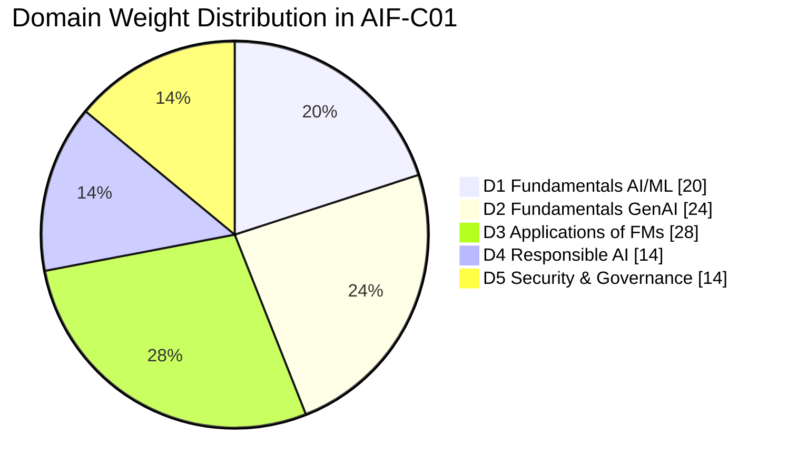

# AWS Certified AI Practitioner (AIF-C01) — Preparation Guide

[Español](README.md) · **English** · [← Back to Blend360 Home](../README.en.md)

[](https://aws.amazon.com/certification/certified-ai-practitioner/)
[](#table-of-contents)
[](domains/00-exam-guide-v1.1-changes.md)
[](CONTRIBUTING.md)

Technical, modular documentation to prepare for the **AWS Certified AI Practitioner (AIF-C01)** exam, tailored for cloud engineers, developers, and data specialists. It combines domain-aligned theory, service decision frameworks, hands-on labs with least-privilege IAM and cost estimation, quick-reference cheatsheets, and original practice questions.

> **Notice:** Community study material not affiliated with Amazon Web Services. AWS services evolve rapidly: always cross-reference with the [official exam guide](https://docs.aws.amazon.com/aws-certification/latest/ai-practitioner-01/ai-practitioner-01.html) and AWS documentation. Practice questions are original and not from real exams.

---

## Where do I start?

| Your situation | Start here |
|---|---|
| **Already took the exam and did not pass** | [4-week retake plan](guides/retake-plan.md) (domain-by-domain diagnosis, schedule, and re-booking criteria) |
| **Studied with materials older than May 2026** | [v1.1 Guide changes](domains/00-exam-guide-v1.1-changes.md): Agentic AI, MCP, AgentCore, Kiro, Strands, tokens, grounding |
| **Starting from scratch** | [Blend360 Phase 1 study plan](../guides/plan-de-estudio.en.md#phase-1-aws-aif-c01--blend360-base) |
| **Looking for courses, videos, books & mock tests** | [Resource center](resources/README.md) |
| **Want to test your current score** | [Interactive simulator](simulator/README.md) · [Mock Exam 01](practice-questions/mock-exam-01.md) ([EN](practice-questions/en/mock-exam-01.md)) · [Mock Exam 02](practice-questions/mock-exam-02.md) ([EN](practice-questions/en/mock-exam-02.md)) |
| **Confusing similar services** | [Confusable pairs](cheatsheets/confusable-pairs.md) (Clarify vs. Model Monitor, CloudTrail vs. invocation logging, Bedrock vs. JumpStart…) |
| **Taking the exam in a few days** | [Final 48-hour review](cheatsheets/final-review-48h.md) + [Exam playbook](guides/exam-playbook.md) |

---

## Table of Contents

- [The Exam at a Glance](#the-exam-at-a-glance)
- [Domains](#domains)
- [Study Materials](#study-materials)
- [Directory Structure](#directory-structure)
- [Hands-on Lab](#hands-on-lab)

---

## The Exam at a Glance

| Aspect | Detail |
|---|---|
| **Code** | AIF-C01 |
| **Level** | Foundational |
| **Target Candidate** | Up to 6 months of exposure to AI/ML on AWS; utilizes (not necessarily builds) AI/ML solutions |
| **Questions** | 65 (50 scored + 15 unscored) |
| **Question Types** | Multiple choice, multiple response, ordering, matching, case studies |
| **Duration** | 90 minutes |
| **Passing Score** | 700 / 1000 |
| **Cost** | USD 100 |
| **Languages** | English, Spanish (Latin America & Spain), Japanese, Korean, Simplified Chinese, etc. If testing in English as non-native, request **ESL +30 min** before scheduling |
| **Guide Version** | **v1.1** (Apr 30, 2026): see [updates](domains/00-exam-guide-v1.1-changes.md) |
| **Retake Policy** | 14-day mandatory waiting period after a failed attempt |
| **Validity** | 3 years |

---

## Domains

| # | Domain | Weight | Document | Key Topics |
|---|---|---|---|---|
| | v1.1 Exam Guide Changes | — | [`domains/00-exam-guide-v1.1-changes.md`](domains/00-exam-guide-v1.1-changes.md) | Agentic AI, MCP, context engineering, tokens, AgentCore, Kiro, Strands, AWS Transform, Amazon Quick |
| 1 | Fundamentals of AI and ML | **20 %** | [`domains/01-fundamentals-ai-ml`](domains/01-fundamentals-ai-ml/README.md) | AI/ML/DL/GenAI, learning types, ML lifecycle, evaluation metrics |
| 2 | Fundamentals of Generative AI | **24 %** | [`domains/02-fundamentals-generative-ai`](domains/02-fundamentals-generative-ai/README.md) | FMs & LLMs, tokens, temperature/Top-P/Top-K, RAG vs. fine-tuning, hallucinations |
| 3 | Applications of Foundation Models | **28 %** | [`domains/03-applications-foundation-models`](domains/03-applications-foundation-models/README.md) | Bedrock (KB, Agents, Guardrails), JumpStart, AI services, Amazon Q |
| 4 | Guidelines for Responsible AI | **14 %** | [`domains/04-responsible-ai`](domains/04-responsible-ai/README.md) | Fairness, explainability, Clarify, Model Cards, Model Monitor, privacy |
| 5 | Security, Compliance, and Governance | **14 %** | [`domains/05-security-compliance-governance`](domains/05-security-compliance-governance/README.md) | Shared responsibility, IAM, PrivateLink, CloudTrail/CloudWatch, cost management |



---

## Study Materials

| Type | Content |
|---|---|
| Theory | [5 domains](domains/) + [v1.1 updates](domains/00-exam-guide-v1.1-changes.md) |
| Practice Exams | [Interactive simulator](simulator/README.md) · [Mock Exam 01](practice-questions/mock-exam-01.md) ([EN](practice-questions/en/mock-exam-01.md)) · [Mock Exam 02](practice-questions/mock-exam-02.md) ([EN](practice-questions/en/mock-exam-02.md)) · [30 questions per domain](practice-questions/README.md) |
| Flashcards | [109 Anki-compatible flashcards](flashcards/README.md) (`aif-c01-flashcards.csv`) |
| Cheatsheets | [Confusable pairs](cheatsheets/confusable-pairs.md) · [Decision matrix (40 scenarios)](cheatsheets/exam-decision-matrix.md) · [Final 48-hour review](cheatsheets/final-review-48h.md) · [ES-EN Glossary](cheatsheets/glossary.md) |
| Guides | [Retake plan](guides/retake-plan.md) · [Exam playbook](guides/exam-playbook.md) |
| Hands-on Lab | [Lab 01 — RAG with Bedrock Knowledge Bases](labs/lab-01-rag-bedrock-knowledge-bases/README.md) · [Workshops and challenges](resources/hands-on.md) |
| Resources | [Official AWS](resources/official-aws.md) · [Videos & courses](resources/videos-and-courses.md) · [Practice exams](resources/practice-exams.md) · [Books & community](resources/books-flashcards-community.md) |

---

## Directory Structure

```text
aws-ai-practitioner/
├── README.md                                   # Spanish entry point
├── README.en.md                                # This document (English entry point)
├── cheatsheets/                                # Quick-decision sheets & review
│   ├── confusable-pairs.md
│   ├── exam-decision-matrix.md
│   ├── final-review-48h.md
│   └── glossary.md
├── domains/                                    # Theoretical modules for the 5 exam domains
│   ├── 00-exam-guide-v1.1-changes.md
│   ├── 01-fundamentals-ai-ml/
│   ├── 02-fundamentals-generative-ai/
│   ├── 03-applications-foundation-models/
│   ├── 04-responsible-ai/
│   └── 05-security-compliance-governance/
├── flashcards/                                 # 109 CSV flashcards for Anki/Quizlet
├── guides/                                     # Playbook and retake plan
├── labs/                                       # Hands-on labs (e.g. Bedrock Knowledge Bases)
├── practice-questions/                         # 130 mock exam questions (ES/EN) + domain banks
├── resources/                                  # Curated external resources
└── simulator/                                  # Standalone web simulator
```

---

## Hands-on Lab

Check out the practical implementation lab:

- [Lab 01: RAG with Amazon Bedrock Knowledge Bases](labs/lab-01-rag-bedrock-knowledge-bases/README.md)
  - Python scripts with boto3
  - IAM least-privilege policies
  - Real sample documents and cost estimation
