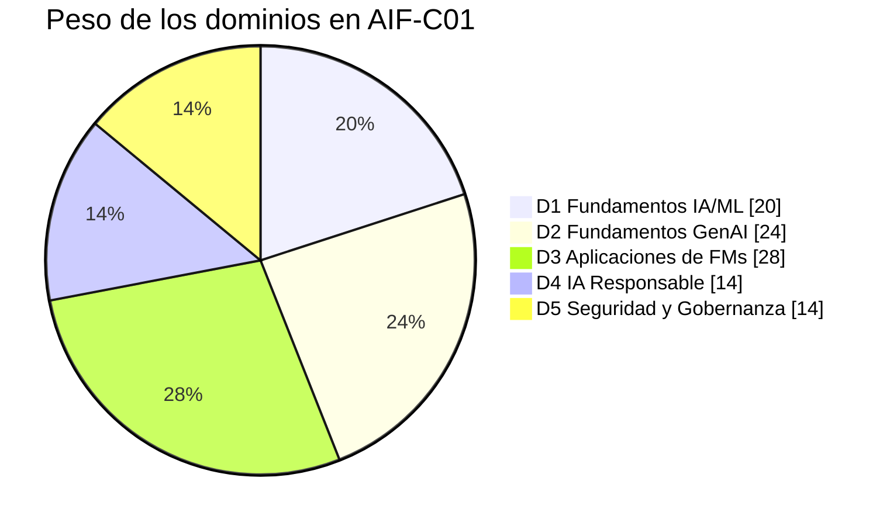

# AWS Certified AI Practitioner (AIF-C01) — Guía de Preparación en Español

**Español** · [English](README.en.md) · [← Volver al inicio de Blend360](../README.md)

[](https://aws.amazon.com/certification/certified-ai-practitioner/)
[](#roadmap)
[](https://github.com/FRANK1808K/AWS-IA-PRACTITIONER-EN-ESPA-OL/actions/workflows/docs-lint.yml)
[](#índice)
[](#roadmap)
[](domains/00-exam-guide-v1.1-changes.md)
[](CONTRIBUTING.md)

Documentación técnica, modular y en español para preparar el examen **AWS Certified AI Practitioner (AIF-C01)**, orientada a ingenieros cloud, desarrolladores y especialistas en datos. Combina teoría alineada con los dominios oficiales, criterios de selección de servicios, laboratorios prácticos con IAM de mínimo privilegio y estimación de costos, cheatsheets de decisión rápida y preguntas de práctica originales.

> **Aviso:** proyecto comunitario no afiliado a Amazon Web Services. Los servicios de AWS evolucionan rápidamente: contrasta siempre con la [guía oficial del examen](https://docs.aws.amazon.com/aws-certification/latest/ai-practitioner-01/ai-practitioner-01.html) y la documentación oficial. Las preguntas de práctica son originales y no proceden de exámenes reales.

## ¿Por dónde empiezo?

| Tu situación | Empieza aquí |
|---|---|
| **Ya hice el examen y no aprobé** | [Plan de reintento de 4 semanas](guides/retake-plan.md) (diagnóstico por dominios, calendario y criterios para volver a reservar) |
| **Estudié con material anterior a mayo de 2026** | [Novedades de la guía v1.1](domains/00-exam-guide-v1.1-changes.md): IA agéntica, MCP, AgentCore, Kiro, Strands, tokens, grounding |
| **Empiezo desde cero** | [Guía de estudio de 6 semanas](#guía-de-estudio-recomendada) |
| **Busco cursos, videos, libros y simulacros** | [Centro de recursos](resources/README.md) (ruta mínima "sí o sí" con 10 recursos) |
| **Quiero medir mi nivel** | [Simulador interactivo con cronómetro](simulator/README.md) · [Simulacro 01](practice-questions/mock-exam-01.md) · [Simulacro 02](practice-questions/mock-exam-02.md) |
| **Fallo al elegir entre servicios parecidos** | [Pares que se confunden](cheatsheets/confusable-pairs.md) (Clarify vs. Model Monitor, CloudTrail vs. invocation logging, Bedrock vs. JumpStart…) |
| **Me examino en pocos días** | [Repaso final 48 h](cheatsheets/final-review-48h.md) + [playbook del examen](guides/exam-playbook.md) |

---

## Índice

- [El examen en una tabla](#el-examen-en-una-tabla)
- [Dominios](#dominios)
- [Material de estudio](#material-de-estudio)
- [Estructura de directorios](#estructura-de-directorios)
- [Guía de estudio recomendada](#guía-de-estudio-recomendada)
- [Roadmap](#roadmap)
- [Cómo contribuir](#cómo-contribuir)
- [Recursos oficiales](#recursos-oficiales)

---

## El examen en una tabla

| Aspecto | Detalle |
|---|---|
| **Código** | AIF-C01 |
| **Nivel** | Foundational |
| **Candidato objetivo** | Hasta 6 meses de exposición a IA/ML en AWS; usa (no necesariamente construye) soluciones de IA/ML |
| **Preguntas** | 65 (50 puntúan + 15 sin puntuación) |
| **Tipos de pregunta** | Opción múltiple, respuesta múltiple, ordenación, emparejamiento, casos de estudio |
| **Duración** | 90 minutos |
| **Puntaje mínimo** | 700 / 1000 |
| **Costo** | USD 100 |
| **Idiomas** | Incluye **español (Latinoamérica)** y **español (España)**. Si lo haces en inglés, pide **ESL +30 min** antes de reservar ([cómo](guides/exam-playbook.md#12-cómo-pedir-esl-30-solo-si-haces-el-examen-en-inglés)) |
| **Versión de la guía** | **v1.1** (30-abr-2026): ver [novedades](domains/00-exam-guide-v1.1-changes.md) |
| **Reintento** | Tras un suspenso, hay que esperar **14 días** |
| **Vigencia** | 3 años |

---

## Dominios

| # | Dominio | Peso | Documento | Temas clave |
|---|---|---|---|---|
| | Novedades de la guía v1.1 | — | [`domains/00-exam-guide-v1.1-changes.md`](domains/00-exam-guide-v1.1-changes.md) | IA agéntica, MCP, context engineering, tokens, AgentCore, Kiro, Strands, AWS Transform, Amazon Quick |
| 1 | Fundamentos de IA y ML | **20 %** | [`domains/01-fundamentals-ai-ml`](domains/01-fundamentals-ai-ml/README.md) | AI/ML/DL/GenAI, tipos de aprendizaje, ciclo de vida de ML, métricas |
| 2 | Fundamentos de IA Generativa | **24 %** | [`domains/02-fundamentals-generative-ai`](domains/02-fundamentals-generative-ai/README.md) | FMs y LLMs, tokens, temperatura/Top-P/Top-K, RAG vs. fine-tuning, alucinaciones |
| 3 | Aplicaciones de Modelos Fundacionales | **28 %** | [`domains/03-applications-foundation-models`](domains/03-applications-foundation-models/README.md) | Bedrock (KB, Agents, Guardrails), JumpStart, servicios de IA, Amazon Q |
| 4 | Directrices de IA Responsable | **14 %** | [`domains/04-responsible-ai`](domains/04-responsible-ai/README.md) | Equidad, explicabilidad, Clarify, Model Cards, Model Monitor, privacidad |
| 5 | Seguridad, Cumplimiento y Gobernanza | **14 %** | [`domains/05-security-compliance-governance`](domains/05-security-compliance-governance/README.md) | Responsabilidad compartida, IAM, PrivateLink, CloudTrail/CloudWatch, costos |

## Material de estudio

| Tipo | Contenido |
|---|---|
| Teoría | [5 dominios](domains/) + [novedades v1.1](domains/00-exam-guide-v1.1-changes.md) |
| Exámenes | [Simulador interactivo (con «Ver en inglés»)](simulator/README.md) · [Simulacro 01](practice-questions/mock-exam-01.md) · [Simulacro 02](practice-questions/mock-exam-02.md) (65 + 65) · [30 preguntas por dominio](practice-questions/README.md) |
| Flashcards | [109 tarjetas importables en Anki/Quizlet](flashcards/README.md) |
| Cheatsheets | [Pares que se confunden](cheatsheets/confusable-pairs.md) · [Matriz de decisión (40 escenarios)](cheatsheets/exam-decision-matrix.md) · [Repaso final 48 h](cheatsheets/final-review-48h.md) · [Glosario ES–EN](cheatsheets/glossary.md) |
| Guías | [Plan de reintento](guides/retake-plan.md) · [Playbook del examen](guides/exam-playbook.md) |
| Práctica | [Lab 01 — RAG con Bedrock](labs/lab-01-rag-bedrock-knowledge-bases/README.md) · [workshops y retos](resources/hands-on.md) |
| Recursos externos | [Oficiales de AWS](resources/official-aws.md) · [Videos y cursos](resources/videos-and-courses.md) · [Exámenes de práctica](resources/practice-exams.md) · [Libros, flashcards y comunidad](resources/books-flashcards-community.md) |



---

## Estructura de directorios

```text
.
├── README.md                                   # Este documento: visión general, plan de estudio y roadmap
├── CONTRIBUTING.md                             # Convenciones de nombres, estilo y flujo de contribución
├── .markdownlint-cli2.jsonc                    # Reglas de estilo Markdown
├── .github/
│   ├── scripts/check_links.py                  # Validación de enlaces relativos y anclas
│   └── workflows/docs-lint.yml                 # CI: markdownlint + enlaces + JSON + sintaxis Python
├── domains/                                    # Teoría por dominio oficial del examen
│   ├── 00-exam-guide-v1.1-changes.md           # Novedades de la guía v1.1 (abr-2026)
│   ├── 01-fundamentals-ai-ml/README.md         # D1 (20 %)
│   ├── 02-fundamentals-generative-ai/README.md # D2 (24 %)
│   ├── 03-applications-foundation-models/README.md  # D3 (28 %)
│   ├── 04-responsible-ai/README.md             # D4 (14 %)
│   └── 05-security-compliance-governance/README.md  # D5 (14 %)
├── labs/                                       # Laboratorios prácticos en AWS
│   ├── README.md                               # Catálogo de labs y reglas de seguridad
│   ├── template.md                             # Plantilla estándar de laboratorio
│   └── lab-01-rag-bedrock-knowledge-bases/
│       ├── README.md                           # Guía paso a paso (CLI), costos y limpieza
│       ├── policies/                           # Trust/permissions IAM y políticas de OpenSearch Serverless
│       ├── scripts/                            # create_vector_index.py, query_kb.py, requirements.txt
│       └── sample-data/                        # Documentos ficticios a indexar
├── cheatsheets/                                # Repaso rápido
│   ├── README.md
│   ├── confusable-pairs.md                     # Pares de servicios/conceptos que se confunden y la pista que decide
│   ├── exam-decision-matrix.md                 # 40 escenarios requisito + restricción → servicio
│   ├── final-review-48h.md                     # Lo imprescindible para las últimas 48 h
│   └── glossary.md                             # Glosario español–inglés
├── guides/                                     # Estrategia
│   ├── retake-plan.md                          # Plan de reintento de 4 semanas por dominios
│   └── exam-playbook.md                        # Inscripción (idioma, ESL +30), tiempo y técnica de respuesta
├── resources/                                  # Recursos externos curados
│   ├── README.md                               # Ruta mínima "sí o sí" (10 recursos)
│   ├── official-aws.md                         # Guías, Skill Builder, documentación, whitepapers
│   ├── videos-and-courses.md                   # Cursos y videos en español e inglés
│   ├── practice-exams.md                       # Simulacros oficiales y de terceros + método
│   ├── books-flashcards-community.md           # Libros, flashcards, GitHub, blogs, comunidades
│   └── hands-on.md                             # Workshops, PartyRock y mini-retos de consola
├── flashcards/                                 # 109 tarjetas CSV para Anki/Quizlet
├── simulator/                                  # Simulador HTML en blanco con cronómetro, «Ver en inglés» e informe por dominio
└── practice-questions/                         # Banco de preguntas originales
    ├── README.md                               # Formato del examen y plantilla de preguntas
    ├── mock-exam-01.md                         # Simulacro completo de 65 preguntas (v1.1)
    ├── mock-exam-02.md                         # Simulacro de escenario de 65 preguntas, más difícil
    ├── en/mock-exam-0{1,2}.md                  # Versiones en inglés de los simulacros
    └── domain-0{1..5}-questions.md
```

---

## Guía de estudio recomendada

Plan de **6 semanas** con una dedicación de **6–8 horas por semana**. Los pesos del examen guían la asignación de tiempo: el Dominio 3 recibe dos semanas.

| Semana | Objetivos | Entregables | Servicios clave | Horas |
|---|---|---|---|---|
| **1** — D1 | Dominar la terminología de IA/ML, los tipos de aprendizaje, el ciclo de vida de ML y las métricas. | Mapa mental AI/ML/DL/GenAI · Tabla propia "métrica → cuándo priorizarla" · [Preguntas D1](practice-questions/domain-01-questions.md) ≥ 80 % | SageMaker AI (Canvas, Autopilot, Ground Truth, Data Wrangler, Feature Store, Pipelines, Model Registry) | 6 |
| **2** — D2 | Comprender FMs/LLMs, tokens, parámetros de inferencia y técnicas de adaptación; reconocer limitaciones. | Tabla comparativa PE vs. RAG vs. FT vs. pre-entrenamiento explicada con tus palabras · Experimentar con temperatura/Top-P en el *playground* de Bedrock · [Preguntas D2](practice-questions/domain-02-questions.md) ≥ 80 % | Amazon Bedrock (playground, Converse API), Titan Embeddings | 7 |
| **3** — D3 (I) | Diseñar soluciones con Bedrock: selección de modelos, Knowledge Bases, Agents, Guardrails, personalización. | **[Lab 01 — RAG](labs/lab-01-rag-bedrock-knowledge-bases/README.md)** completado y limpiado · Diagrama propio de un agente con action groups | Bedrock Knowledge Bases, Agents, Guardrails, OpenSearch Serverless, Lambda | 8 |
| **4** — D3 (II) | Decidir entre Bedrock y JumpStart; dominar los servicios de IA aplicada y Amazon Q; evaluación de FMs. | Tabla "servicio → caso de uso → cuándo NO usarlo" memorizada · [Preguntas D3](practice-questions/domain-03-questions.md) ≥ 80 % | SageMaker JumpStart, Comprehend, Rekognition, Textract, Polly, Transcribe, Lex, Q Developer/Business, Q in QuickSight, Bedrock Model Evaluation | 8 |
| **5** — D4 + D5 | Aplicar IA responsable y seguridad: sesgo, explicabilidad, responsabilidad compartida, IAM, PrivateLink, auditoría, costos. | Políticas IAM de ejemplo comentadas · Matriz On-Demand vs. Batch vs. Provisioned Throughput · [Preguntas D4](practice-questions/domain-04-questions.md) y [D5](practice-questions/domain-05-questions.md) ≥ 80 % | SageMaker Clarify, Model Cards, Model Monitor, A2I, IAM, KMS, VPC endpoints, CloudTrail, CloudWatch, Macie, Organizations (SCP) | 8 |
| **6** — Repaso | Consolidar, detectar puntos débiles y simular condiciones reales. | Repaso de la [matriz de decisión](cheatsheets/exam-decision-matrix.md) · Examen de práctica oficial en AWS Skill Builder ≥ 80 % · Reserva del examen | Todos | 6–8 |

**Variante intensiva (3 semanas, ~15 h/semana):** semana 1 → D1 + D2 · semana 2 → D3 + Lab 01 · semana 3 → D4 + D5 + simulacros.

### Método recomendado por sesión

1. **Leer** el documento del dominio (teoría + tablas de decisión).
2. **Practicar** en la consola o con el laboratorio correspondiente.
3. **Responder** las preguntas del dominio sin mirar las soluciones.
4. **Registrar** errores y respuestas con baja confianza en un log personal.
5. **Repasar** con los [cheatsheets](cheatsheets/) a las 24 h y a los 7 días (repetición espaciada).

---

## Roadmap

| Versión | Estado | Alcance |
|---|---|---|
| **v1.0** | ✓ Publicado | 5 dominios completos · Plantilla de laboratorio · Lab 01 (RAG) · Matriz de decisión (40 escenarios) · Glosario · 30 preguntas de práctica · CI de documentación |
| **v1.1** | ✓ Publicado | Novedades de la guía v1.1 · Centro de recursos (oficiales, videos, simulacros, libros, labs) · Simulacro 01 (65 preguntas) · 109 flashcards · Plan de reintento · Playbook del examen · Repaso 48 h |
| **v1.2** | ✓ Publicado | Simulacro 02 · Simulador interactivo · Pares que se confunden |
| **v1.3** | Planificado | Lab 02 (Guardrails) · Lab 03 (Bedrock Agents / AgentCore) · Preguntas de casos de estudio |
| **v1.4** | Planificado | Lab 04 (Clarify) · Lab 05 (PrivateLink + auditoría) · Versión IaC (CDK/Terraform) del Lab 01 |
| **v2.0** | Propuesta | Simulacro 03 con casos de estudio · Licencia de contenido definida |

¿Quieres proponer algo? Abre un *issue* con la etiqueta `enhancement`.

---

## Cómo contribuir

Las contribuciones son bienvenidas. Resumen de reglas (detalle completo en [`CONTRIBUTING.md`](CONTRIBUTING.md)):

| Aspecto | Convención |
|---|---|
| **Directorios y archivos** | `kebab-case`, en inglés, con prefijo numérico de dos dígitos cuando hay orden: `domains/03-applications-foundation-models/`, `labs/lab-02-bedrock-guardrails/`. |
| **Idioma del contenido** | Español neutro. Los nombres de servicios, APIs, parámetros y términos técnicos establecidos se mantienen en inglés (`Provisioned Throughput`, `RetrieveAndGenerate`, *fine-tuning*). |
| **Encabezados** | Un único `#` por documento; secciones numeradas `## 1.`, `### 1.1`. |
| **Tablas** | Para comparaciones y criterios de decisión; columna de "cuándo NO usarlo" cuando aplique. |
| **Diagramas** | Mermaid para flujos; ASCII en bloques de código `text` para jerarquías y estructuras. |
| **Código** | Bloques con lenguaje declarado (`bash`, `json`, `python`); sin credenciales ni IDs de cuenta reales (usa `111122223333` o `__ACCOUNT_ID__`). |
| **Preguntas** | Originales (nunca de *dumps*), con justificación de **todas** las opciones y enlace a la sección del dominio. |
| **Commits** | [Conventional Commits](https://www.conventionalcommits.org/es/v1.0.0/): `docs(d3): añade Bedrock Flows`, `feat(labs): lab 02 guardrails`, `fix(questions): corrige respuesta D2-Q4`. |
| **Calidad** | La CI (`markdownlint`, validación de enlaces, JSON y Python) debe pasar antes de fusionar. |

---

## Recursos oficiales

> Catálogo completo y clasificado en el [Centro de recursos](resources/README.md).

- [Página de la certificación AWS Certified AI Practitioner](https://aws.amazon.com/certification/certified-ai-practitioner/)
- [Guía oficial del examen AIF-C01](https://docs.aws.amazon.com/aws-certification/latest/ai-practitioner-01/ai-practitioner-01.html)
- [AWS Skill Builder](https://skillbuilder.aws/) — Exam Prep Plan, Official Practice Question Set y Official Practice Exam
- [Documentación de Amazon Bedrock](https://docs.aws.amazon.com/bedrock/)
- [Documentación de Amazon SageMaker AI](https://docs.aws.amazon.com/sagemaker/)
- [AWS Responsible AI](https://aws.amazon.com/ai/responsible-ai/)
- [Generative AI Security Scoping Matrix](https://aws.amazon.com/ai/generative-ai/security/scoping-matrix/)
- [AWS Well-Architected — Generative AI Lens](https://docs.aws.amazon.com/wellarchitected/latest/generative-ai-lens/generative-ai-lens.html)
