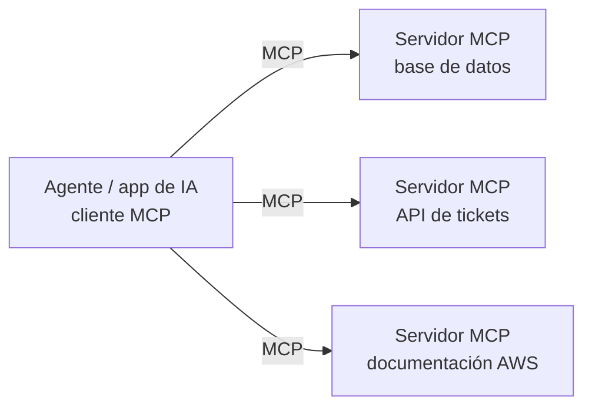

# Novedades de la guía AIF-C01 v1.1 (abril 2026) — Lo que el material antiguo NO cubre

> **Por qué importa:** AWS publicó la **versión 1.1** de la guía del examen el **30 de abril de 2026**. Los cambios llegan al examen aproximadamente un mes después de publicarse, así que **ya están en vigor**. Los cinco dominios y sus pesos (20/24/28/14/14) no cambian, pero se añadieron objetivos sobre **IA agéntica, MCP, context engineering, precios por token y detección de alucinaciones**, además de varios servicios nuevos.
>
> ⚠️ Muchos cursos, libros y bancos de preguntas publicados **antes de mayo de 2026** no incluyen estos temas. Estudia este documento aunque uses otro material.

**Fuentes:** [página de revisiones oficial](https://docs.aws.amazon.com/aws-certification/latest/ai-practitioner-01/aif-01-revisions.html), [servicios en alcance](https://docs.aws.amazon.com/aws-certification/latest/ai-practitioner-01/aif-01-in-scope-services.html), [guía en PDF (inglés)](https://docs.aws.amazon.com/pdfs/aws-certification/latest/ai-practitioner-01/ai-practitioner-01.pdf) y [guía en PDF (español)](https://docs.aws.amazon.com/es_es/aws-certification/latest/ai-practitioner-01/ai-practitioner-01.pdf). Compilado en 2026-10 a partir de extractos de esas páginas y de análisis de terceros; **contrasta siempre con la página de revisiones**, que es la referencia autoritativa.

---

## 1. Resumen de cambios

### 1.1 Objetivos nuevos

| Objetivo | Texto (resumido) | Dominio de este repo | Sección |
|---|---|---|---|
| **1.2.6** | Cuándo usar **ML tradicional frente a foundation models** (restricciones regulatorias, de explicabilidad u operativas). | D1 | [§2](#2-ml-tradicional-vs-foundation-models-126) |
| **2.1.4** | **Precios basados en tokens** y su efecto en el costo y el rendimiento de la inferencia. | D2 | [§3](#3-precios-basados-en-tokens-214) |
| **2.1.5** | El papel del **context engineering** en las aplicaciones con FMs. | D2 | [§4](#4-context-engineering-215) |
| **2.1.6** | Conceptos básicos de **IA agéntica**: patrones multi-agente, **Model Context Protocol (MCP)**, memoria, uso de herramientas y orquestación de flujos. | D2 | [§5](#5-ia-agéntica-mcp-y-patrones-multi-agente-216) |
| **3.2.5** | **Versionado y gestión de prompts** con Amazon Bedrock Prompt Management. | D3 | [§6](#6-versionado-de-prompts-con-bedrock-prompt-management-325) |
| **3.4.5** | **Métricas de alineación con el negocio**: tasa de tareas completadas, satisfacción del usuario, costo por interacción. | D3 | [§7](#7-métricas-de-alineación-con-el-negocio-345) |
| **5.1.5** | **Detección de alucinaciones y grounding**: grounding con RAG, validación de la salida y puntuación de confianza. | D5 | [§8](#8-detección-de-alucinaciones-y-grounding-515) |

### 1.2 Objetivos ampliados

| Objetivo | Qué se añadió |
|---|---|
| **1.1.1** | *Generative AI* y **agentic AI** entran en la lista de términos básicos que debes definir. |
| **1.1.2** | La comparación entre AI, ML, DL y GenAI incluye ahora la **IA agéntica**. |
| **1.2.4** | Aplicaciones reales de la IA agéntica. |
| **3.1.5** | **Model distillation** se suma a las opciones de personalización (pre-entrenamiento, fine-tuning, in-context learning, RAG) en el análisis de costos. |
| **3.4.2** | **LLM-as-a-judge** se suma a ROUGE, BLEU y BERTScore como método de evaluación. |
| **4.2.2** | Herramientas de explicabilidad: **SageMaker Clarify** y **Amazon Bedrock Model Evaluations**. |
| **5.1.1** | Seguridad de agentes con **AgentCore Identity** y **Policy in AgentCore**. |

### 1.3 Cambios en los servicios en alcance

| Cambio | Servicios |
|---|---|
| ➕ **Añadidos** | Amazon Aurora · **Amazon Bedrock AgentCore** · **Kiro** · **Strands Agents** · Amazon Q · Amazon SageMaker JumpStart · **AWS Transform** |
| ➖ **Eliminado** | Amazon MemoryDB |
| ℹ️ **Mencionado en objetivos** | **Amazon Quick** (evolución de QuickSight) aparece como ejemplo al mapear servicios a las etapas del pipeline de IA/ML. |

> Algunas fuentes secundarias citan "Amazon Quick" en lugar de "AWS Transform" en la lista de añadidos. Estudia ambos: son ligeros y aparecen en preguntas de "¿qué servicio usarías?".

---

## 2. ML tradicional vs. foundation models (1.2.6)

Un FM **no** es siempre la mejor opción. El examen pregunta cuándo un modelo clásico (XGBoost, regresión, árbol de decisión) es preferible.

| Criterio | ML tradicional | Foundation model |
|---|---|---|
| **Tipo de datos** | Estructurados/tabulares | No estructurados (texto, imagen, audio) |
| **Tarea** | Predicción/clasificación bien definida (riesgo de crédito, churn, demanda) | Generación, resumen, conversación, razonamiento abierto |
| **Explicabilidad** | Alta (coeficientes, SHAP, árboles interpretables) | Baja (caja negra; explicaciones aproximadas) |
| **Requisitos regulatorios** | Más fácil de auditar y justificar decisiones individuales | Difícil justificar decisiones automatizadas de alto impacto |
| **Determinismo** | Misma entrada → misma salida | Salida no determinista |
| **Costo de inferencia** | Muy bajo (CPU, milisegundos) | Mayor (pago por token, GPU) |
| **Latencia** | Muy baja | Mayor |
| **Datos necesarios** | Datos etiquetados propios | Pocos o ninguno (in-context learning) |
| **Tiempo de puesta en marcha** | Requiere entrenar y validar | Rápido (prompting, RAG) |

> **Regla de examen:** decisión regulada sobre datos tabulares que debe explicarse a un regulador o cliente (crédito, seguros, contratación) → **ML tradicional + SageMaker Clarify**. Tarea de lenguaje abierta sobre texto no estructurado → **FM**.

---

## 3. Precios basados en tokens (2.1.4)

- Los FMs se facturan por **tokens de entrada** (prompt + contexto + historial + documentos recuperados) y **tokens de salida** (respuesta). Los de **salida suelen costar varias veces más** que los de entrada.
- Más tokens implican **más costo y más latencia**: el tiempo de generación crece con los tokens de salida.

**Ejemplo de cálculo** (precios de referencia de Amazon Nova Lite: ≈ USD 0,06 por millón de tokens de entrada y ≈ USD 0,24 por millón de salida):

```text
10 000 peticiones/día × 1 500 tokens de entrada = 15 M tokens → 15 × 0,06 = USD 0,90
10 000 peticiones/día ×   300 tokens de salida  =  3 M tokens →  3 × 0,24 = USD 0,72
                                                                Total ≈ USD 1,62/día
```

| Palanca | Efecto en el costo |
|---|---|
| Recortar el prompt y enviar solo los chunks relevantes (RAG) | ↓ tokens de entrada |
| Limitar `maxTokens` y pedir respuestas concisas | ↓ tokens de salida |
| **Prompt caching** de prefijos repetidos | ↓ costo de los tokens de entrada cacheados |
| Modelo más pequeño / **distillation** / Intelligent Prompt Routing | ↓ precio por token |
| **Batch inference** | ≈ 50 % de descuento si no hace falta tiempo real |
| **Provisioned Throughput** | Costo fijo por hora: compensa solo con tráfico alto y estable |

---

## 4. Context engineering (2.1.5)

**Context engineering** es la disciplina de **decidir qué información entra en la ventana de contexto del modelo** (y en qué forma y orden) para que produzca la mejor respuesta posible. Es más amplio que el prompt engineering: el prompt engineering se centra en *cómo redactar la instrucción*; el context engineering gestiona *todo lo que el modelo ve*.

```text
┌──────────────────────── Ventana de contexto ────────────────────────┐
│ 1. Instrucciones del sistema (rol, reglas, formato de salida)        │
│ 2. Ejemplos (few-shot)                                               │
│ 3. Definiciones de herramientas disponibles (tools / MCP)            │
│ 4. Memoria: historial reciente + resúmenes/preferencias a largo plazo│
│ 5. Conocimiento recuperado (RAG: chunks de la Knowledge Base)        │
│ 6. Estado de la tarea y resultados de herramientas previas           │
│ 7. Pregunta actual del usuario                                       │
└──────────────────────────────────────────────────────────────────────┘
```

| Técnica | Para qué |
|---|---|
| **Seleccionar** solo lo relevante (RAG, filtros por metadatos, reranking) | Evitar ruido que confunde al modelo y encarece la petición. |
| **Comprimir / resumir** el historial | No agotar la ventana de contexto en conversaciones largas. |
| **Estructurar** con etiquetas y secciones | Separar instrucciones de datos (también mitiga *prompt injection*). |
| **Memoria a corto y largo plazo** | Recordar el estado de la sesión y las preferencias del usuario entre sesiones. |
| **Ordenar** el contexto | La información clave al principio o al final suele aprovecharse mejor. |
| **Presupuesto de tokens** | Equilibrar calidad, costo y latencia. |

> **En AWS:** Bedrock Knowledge Bases (conocimiento), memoria de Bedrock Agents y **AgentCore Memory** (memoria), definiciones de herramientas en action groups o **AgentCore Gateway** (herramientas), **Prompt Management** (instrucciones versionadas).

---

## 5. IA agéntica, MCP y patrones multi-agente (2.1.6)

### 5.1 ¿Qué es la IA agéntica?

Un **agente de IA** es un sistema que usa un FM para **razonar, planificar y actuar de forma autónoma** hacia un objetivo: decide qué pasos dar, **invoca herramientas** (APIs, bases de datos, código), observa los resultados e itera hasta completar la tarea.

| | GenAI "clásica" (chat) | IA agéntica |
|---|---|---|
| Interacción | Pregunta → respuesta | Objetivo → plan → acciones → resultado |
| Herramientas | No | Sí (APIs, búsqueda, código, otros agentes) |
| Autonomía | Baja | Alta, con bucle *razonar → actuar → observar* (ReAct) |
| Riesgos nuevos | Alucinación, toxicidad | **Agencia excesiva**, acciones no autorizadas, abuso de herramientas |

**Componentes de un agente:** modelo (razonamiento) · instrucciones · **herramientas** · **memoria** (corto y largo plazo) · orquestación · guardrails/políticas.

### 5.2 Model Context Protocol (MCP)

**MCP** es un **protocolo abierto** que estandariza cómo las aplicaciones y agentes de IA se conectan con **herramientas y fuentes de datos externas**. Se suele describir como el "USB-C de la IA": un conector estándar en lugar de una integración a medida por cada herramienta.



- Arquitectura **cliente–servidor**: el agente es el cliente; cada servidor MCP expone **herramientas** (acciones), **recursos** (datos) y **prompts**.
- **En AWS:** **AgentCore Gateway** convierte APIs, funciones Lambda y servidores MCP en herramientas para los agentes; **Strands Agents** y **Kiro** soportan MCP de forma nativa.

### 5.3 Patrones multi-agente

| Patrón | Descripción | Ejemplo |
|---|---|---|
| **Supervisor / orquestador** | Un agente coordinador reparte subtareas entre agentes especialistas y combina sus resultados. | Agente de viajes que delega en agentes de vuelos, hoteles y pagos (Bedrock *multi-agent collaboration*). |
| **Secuencial (pipeline)** | Cada agente procesa y pasa el resultado al siguiente. | Extraer → validar → resumir un contrato. |
| **Paralelo** | Varios agentes trabajan a la vez y se agregan los resultados. | Análisis de un documento desde las perspectivas legal, financiera y técnica. |
| **Swarm / colaboración entre pares** | Los agentes se pasan el control entre sí según la necesidad. | Equipo de investigación autónomo. |
| **Agentes como herramientas** | Un agente invoca a otro como si fuese una herramienta (protocolo A2A). | Agente principal que llama a un agente de cálculo. |

### 5.4 Memoria y orquestación

- **Memoria a corto plazo:** contexto de la sesión actual.
- **Memoria a largo plazo:** hechos, preferencias y resúmenes que persisten entre sesiones (AgentCore Memory, memoria de Bedrock Agents).
- **Orquestación de flujos:** flujos deterministas (Bedrock Flows, AWS Step Functions) frente a orquestación dirigida por el modelo (el agente decide los pasos). Para procesos críticos, combina ambos.

### 5.5 Servicios y herramientas agénticas de AWS

| Servicio | Qué es | Cuándo es la respuesta |
|---|---|---|
| **Amazon Bedrock Agents** | Agentes **totalmente gestionados y configurables** (instrucciones, action groups, Knowledge Bases). | Crear un agente rápido sin gestionar infraestructura ni código de orquestación. |
| **Amazon Bedrock AgentCore** | Servicios modulares para **operar agentes en producción** con **cualquier framework y modelo**: Runtime, Memory, Gateway, Identity, Policy, Observability, Evaluations, Browser y Code Interpreter. | Agentes empresariales a escala, construidos con Strands, LangGraph, CrewAI…, que necesitan seguridad, memoria y observabilidad gestionadas. |
| **Strands Agents** | **SDK open source** (Python y TypeScript) de AWS para construir agentes con un enfoque **"model-driven"**: modelo + system prompt + herramientas; el modelo decide los pasos. Soporta MCP, multi-agente y varios proveedores de modelos. | Desarrolladores que quieren escribir agentes con poco código; se despliegan, por ejemplo, en AgentCore Runtime. |
| **Kiro** | **IDE agéntico** de AWS (basado en Code OSS) con **desarrollo guiado por especificaciones (*spec-driven*)**: requisitos → diseño → tareas antes del código; *steering files* (reglas del proyecto) y *hooks* (acciones automáticas ante eventos). **Kiro CLI** sucede a la Amazon Q Developer CLI. | Desarrollo de software asistido por agentes con estructura y trazabilidad. |
| **Amazon Q Developer** | Asistente de IA para desarrollo y operaciones en AWS (IDE, consola, CLI). | Ayuda con código y recursos de AWS. |
| **Amazon Q Business** | Asistente empresarial sobre datos corporativos respetando permisos. | Preguntas de empleados sobre documentación interna. |
| **AWS Transform** | Servicio **agéntico** de **migración y modernización**: mainframe (COBOL z/OS), **.NET**/Windows → Linux, **VMware** → AWS, reducción de deuda técnica. | "Modernizar aplicaciones heredadas con agentes de IA". |
| **Amazon Quick** (Quick Suite) | Espacio de trabajo con IA agéntica, evolución de QuickSight: **Quick Sight** (BI con lenguaje natural), **Quick Research** (investigación con fuentes citadas), **Quick Flows** (automatizaciones sin código), **Quick Automate** (flujos empresariales multi-paso) y **Quick Index** (conocimiento unificado). | Usuarios de negocio que necesitan BI, investigación y automatización con IA sin programar. |

### 5.6 Seguridad de agentes: AgentCore Identity y Policy (5.1.1)

| Capacidad | Qué controla | Idea clave para el examen |
|---|---|---|
| **AgentCore Identity** | **Quién puede invocar al agente** (autenticación entrante con IAM SigV4 u OAuth/JWT de proveedores como Amazon Cognito, Okta o Microsoft Entra ID) y **con qué credenciales accede el agente a herramientas externas** en nombre del usuario (OAuth 2.0, claves de API guardadas de forma segura). | Gestión de identidades y credenciales del agente **sin incrustar secretos** en el código. |
| **Policy in AgentCore** | Autorización **determinista** de cada llamada a herramienta que pasa por AgentCore Gateway, con políticas escritas en **Cedar** y aplicadas **fuera del agente**. | El LLM **no puede saltarse** la política aunque sufra prompt injection: limita la **agencia excesiva**. |

> **Principio:** aplica **mínimo privilegio** también a los agentes. Cada herramienta debe exponer solo las acciones necesarias, con autorización evaluada fuera del modelo y trazas en AgentCore Observability / CloudWatch.

---

## 6. Versionado de prompts con Bedrock Prompt Management (3.2.5)

**Amazon Bedrock Prompt Management** permite crear, probar, **versionar** y reutilizar prompts:

- **Plantillas con variables** (`{{cliente}}`, `{{documento}}`) y configuración de inferencia asociada (modelo, temperatura, maxTokens).
- **Variantes** para comparar el mismo prompt entre modelos o redacciones.
- **Versiones inmutables** que se referencian desde la aplicación o desde **Bedrock Flows**.

| Beneficio | Por qué importa |
|---|---|
| Reproducibilidad | Sabes exactamente qué prompt generó cada respuesta. |
| Rollback | Vuelves a la versión anterior si la nueva empeora la calidad. |
| Gobernanza | Los cambios de prompt se revisan como cambios de código. |
| Experimentación | Comparas variantes con Bedrock Model Evaluation antes de publicarlas. |

> **Respuesta típica:** "*El equipo necesita controlar los cambios en los prompts de producción y poder volver atrás*" → **Bedrock Prompt Management (versiones)**.

---

## 7. Métricas de alineación con el negocio (3.4.5)

Una aplicación GenAI puede tener un ROUGE excelente y aun así fracasar. Mide su **impacto en el negocio**:

| Métrica | Qué mide | Ejemplo |
|---|---|---|
| **Tasa de tareas completadas** (*task completion rate*) | % de interacciones en que el usuario logra su objetivo sin escalar. | El agente reprograma la cita sin intervención humana. |
| **Satisfacción del usuario** (CSAT, 👍/👎, NPS) | Percepción de utilidad y calidad. | Valoración media de 4,3/5. |
| **Costo por interacción** | Tokens + infraestructura + revisión humana por conversación. | USD 0,02 frente a USD 4 de una llamada atendida por una persona. |
| **Tasa de deflexión / contención** | % de consultas resueltas sin agente humano. | 60 % de tickets resueltos por el asistente. |
| **Tiempo de resolución** | Rapidez con que se resuelve la tarea. | De 2 días a 5 minutos. |
| **Adopción** | Usuarios activos y frecuencia de uso. | 70 % de los empleados lo usan cada semana. |

---

## 8. Detección de alucinaciones y grounding (5.1.5)

| Técnica | Cómo funciona | Servicio AWS |
|---|---|---|
| **Grounding con RAG** | La respuesta se basa en documentos recuperados y se **citan las fuentes**. | Bedrock Knowledge Bases |
| **Contextual grounding check** | Puntúa si la respuesta está **fundamentada** en la fuente y es **relevante** a la pregunta; bloquea por debajo del umbral. | Bedrock Guardrails |
| **Automated Reasoning checks** | Verificación **lógica/matemática** de la respuesta contra políticas formalizadas. | Bedrock Guardrails |
| **Validación de la salida** | Comprobar formato (esquema JSON), reglas de negocio, rangos, entidades válidas; un segundo modelo verifica la respuesta (*LLM-as-a-judge*). | Lambda, Bedrock Model Evaluation |
| **Puntuación de confianza** | Usar las puntuaciones de recuperación, la autoconsistencia (varias muestras coherentes) o umbrales de confianza para decidir si responder, pedir aclaración o **escalar a un humano**. | Scores de `Retrieve`, Amazon A2I |
| **Revisión humana** | Personas revisan las respuestas de baja confianza o de alto riesgo. | Amazon Augmented AI (A2I) |

---

## 9. Preguntas de repaso de la v1.1

Las preguntas sobre estos temas están integradas en el [Simulacro 01](../practice-questions/mock-exam-01.md) (marcadas con 🆕) y en las [flashcards](../flashcards/README.md).

⬅️ [Volver al índice](../README.md) · ➡️ [Dominio 1](01-fundamentals-ai-ml/README.md)
