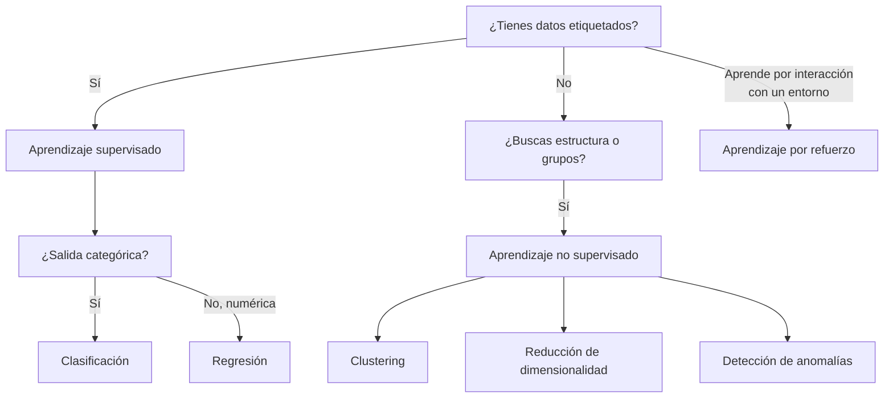
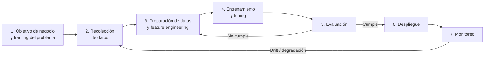

# Dominio 1 — Fundamentos de IA y ML (20 %)

> **Peso en el examen:** 20 % del puntaje con puntuación (≈ 10 de las 50 preguntas que cuentan).
> **Objetivo:** dominar el vocabulario base, saber reconocer qué tipo de problema de ML plantea un escenario y elegir la métrica de evaluación correcta.
>
> 🆕 **Guía v1.1:** este dominio añade la **IA agéntica** a los términos básicos (1.1.1/1.1.2) y el objetivo **1.2.6 — ML tradicional vs. foundation models**. Ver [novedades v1.1](../00-exam-guide-v1.1-changes.md#2-ml-tradicional-vs-foundation-models-126).

## Mapeo a los task statements oficiales

| Task statement oficial | Sección de este documento |
|---|---|
| 1.1 Explicar conceptos y terminología básicos de IA | [Jerarquía AI / ML / DL / GenAI](#1-jerarquía-ai--ml--dl--genai), [Terminología esencial](#2-terminología-esencial) |
| 1.2 Identificar casos de uso prácticos de IA | [Tipos de aprendizaje](#3-tipos-de-aprendizaje), [Cuándo NO usar ML](#4-cuándo-no-usar-ml) |
| 1.3 Describir el ciclo de vida de desarrollo de ML | [Ciclo de vida de ML](#5-ciclo-de-vida-de-ml), [Métricas](#6-métricas-de-evaluación) |

---

## 1. Jerarquía AI / ML / DL / GenAI

```text
┌─────────────────────────────────────────────────────────────┐
│ Inteligencia Artificial (AI)                                │
│  Sistemas que realizan tareas que requieren "inteligencia"  │
│  ┌───────────────────────────────────────────────────────┐  │
│  │ Machine Learning (ML)                                 │  │
│  │  Aprende patrones a partir de datos, sin reglas       │  │
│  │  programadas explícitamente                           │  │
│  │  ┌─────────────────────────────────────────────────┐  │  │
│  │  │ Deep Learning (DL)                              │  │  │
│  │  │  Redes neuronales con muchas capas              │  │  │
│  │  │  ┌───────────────────────────────────────────┐  │  │  │
│  │  │  │ IA Generativa (GenAI)                     │  │  │  │
│  │  │  │  Modelos que GENERAN contenido nuevo      │  │  │  │
│  │  │  │  (texto, imagen, audio, código)           │  │  │  │
│  │  │  └───────────────────────────────────────────┘  │  │  │
│  │  └─────────────────────────────────────────────────┘  │  │
│  └───────────────────────────────────────────────────────┘  │
└─────────────────────────────────────────────────────────────┘
```

| Concepto | Definición operativa | Ejemplo típico | Ejemplo en AWS |
|---|---|---|---|
| **AI** | Disciplina amplia: cualquier técnica que imita capacidades cognitivas (incluye sistemas basados en reglas). | Motor de reglas de negocio, sistema experto. | Amazon Lex (combina NLU + reglas de diálogo). |
| **ML** | Subconjunto de AI: algoritmos que **aprenden de datos** para hacer predicciones o decisiones. | Predicción de churn con XGBoost. | Amazon SageMaker AI (algoritmos integrados). |
| **DL** | Subconjunto de ML basado en **redes neuronales profundas**; aprende representaciones automáticamente de datos no estructurados. | Clasificación de imágenes con CNN. | Amazon Rekognition, Amazon Transcribe. |
| **GenAI** | Subconjunto de DL: modelos (normalmente Transformers o modelos de difusión) que **generan** contenido nuevo. | Chatbot, resumen de documentos, generación de imágenes. | Amazon Bedrock, Amazon Q. |

> **Pista de examen:** si el escenario habla de *predecir/clasificar* sobre datos tabulares → ML clásico. Si habla de *crear/generar/resumir/conversar* → GenAI.

---

## 2. Terminología esencial

| Término | Definición |
|---|---|
| **Modelo** | Artefacto resultante del entrenamiento; función que mapea entradas a salidas. |
| **Algoritmo** | Procedimiento matemático que se usa para entrenar el modelo (p. ej., regresión lineal, XGBoost, k-means). |
| **Entrenamiento (training)** | Proceso de ajustar los parámetros del modelo con datos. |
| **Inferencia (inference)** | Uso del modelo entrenado para producir predicciones sobre datos nuevos. |
| **Feature (característica)** | Variable de entrada (columna) que usa el modelo. |
| **Label / Target (etiqueta)** | Valor que se quiere predecir en aprendizaje supervisado. |
| **Parámetros** | Valores aprendidos durante el entrenamiento (pesos, sesgos). |
| **Hiperparámetros** | Valores definidos **antes** del entrenamiento (learning rate, epochs, batch size, profundidad del árbol). |
| **Overfitting (sobreajuste)** | El modelo memoriza el training set: alto desempeño en entrenamiento, bajo en validación. *Alta varianza.* |
| **Underfitting (subajuste)** | El modelo es demasiado simple: bajo desempeño en ambos conjuntos. *Alto sesgo (bias).* |
| **Fit adecuado** | Bajo sesgo y baja varianza: generaliza bien. |
| **Datos estructurados** | Tabulares (filas/columnas): CSV, tablas relacionales. |
| **Datos no estructurados** | Texto libre, imágenes, audio, video. |
| **Series de tiempo** | Datos ordenados cronológicamente (ventas diarias, telemetría IoT). |
| **Inferencia en tiempo real** | Baja latencia, petición por petición (endpoint síncrono). |
| **Inferencia por lotes (batch)** | Grandes volúmenes, sin requisito de latencia (procesamiento programado). |

### Bias vs. Varianza (compromiso)

| Situación | Síntoma | Remedios comunes |
|---|---|---|
| **Overfitting** (alta varianza) | Train ≫ Validation | Más datos, regularización (L1/L2, dropout), early stopping, reducir complejidad, data augmentation, cross-validation. |
| **Underfitting** (alto sesgo) | Train ≈ Validation, ambos bajos | Modelo más complejo, más features, más epochs, reducir regularización. |

### Opciones de inferencia en Amazon SageMaker AI

| Opción | Cuándo usarla |
|---|---|
| **Real-time endpoint** | Latencia baja (ms), tráfico sostenido. |
| **Serverless inference** | Tráfico intermitente/impredecible; tolera *cold starts*; pago por uso. |
| **Asynchronous inference** | Payloads grandes (hasta 1 GB) o procesamiento largo (hasta 1 h); cola de peticiones; puede escalar a cero. |
| **Batch transform** | Inferencia offline sobre un dataset completo en S3; no requiere endpoint persistente. |

---

## 3. Tipos de aprendizaje



| Tipo | Datos | Objetivo | Algoritmos / técnicas | Casos de uso | AWS |
|---|---|---|---|---|---|
| **Supervisado — Clasificación** | Etiquetados (categoría) | Predecir una clase | Regresión logística, árboles, XGBoost, redes neuronales | Detección de fraude, spam, diagnóstico, churn | SageMaker AI (XGBoost, Linear Learner) |
| **Supervisado — Regresión** | Etiquetados (valor continuo) | Predecir un número | Regresión lineal, XGBoost, redes neuronales | Precio de vivienda, demanda, ingresos | SageMaker AI, SageMaker Canvas |
| **No supervisado — Clustering** | Sin etiquetas | Agrupar elementos similares | K-means, DBSCAN | Segmentación de clientes | SageMaker AI (K-Means) |
| **No supervisado — Reducción de dimensionalidad** | Sin etiquetas | Reducir número de features | PCA | Visualización, preprocesamiento | SageMaker AI (PCA) |
| **No supervisado — Anomalías** | Sin etiquetas | Detectar outliers | Random Cut Forest, Isolation Forest | Fraude, fallos de sensores | SageMaker AI (RCF) |
| **Por refuerzo (RL)** | Recompensas de un entorno | Maximizar recompensa acumulada mediante prueba/error | Q-learning, PPO | Robótica, conducción autónoma, juegos, trading | AWS DeepRacer (didáctico) |
| **Semi-supervisado** | Pocas etiquetas + muchas sin etiquetar | Aprovechar datos no etiquetados | Pseudo-labeling | Clasificación de documentos con poco etiquetado | SageMaker Ground Truth (etiquetado activo) |
| **Auto-supervisado** | Sin etiquetas humanas; la etiqueta sale del propio dato | Pre-entrenamiento de FMs | Predicción del siguiente token, *masked language modeling* | Pre-entrenamiento de LLMs | Base de los FMs en Amazon Bedrock |

> **RLHF (Reinforcement Learning from Human Feedback):** técnica que combina refuerzo con preferencias humanas para alinear LLMs. Aparece en el examen como método de alineación de FMs.

---

## 4. Cuándo NO usar ML

El examen evalúa si sabes reconocer cuándo la IA/ML **no** es la respuesta:

- El resultado debe ser **determinista y exacto** (p. ej., cálculo de impuestos, reglas contables) → una regla o fórmula es más barata y auditable.
- **No hay datos suficientes** o los datos son de baja calidad / no representativos.
- El **costo** de construir y operar el modelo supera el beneficio de negocio.
- Se requiere **explicabilidad total** que el modelo no puede ofrecer (ciertos contextos regulatorios).
- El problema puede resolverse con lógica simple (`if/else`), búsqueda o una consulta SQL.

---

## 5. Ciclo de vida de ML



| Fase | Actividades clave | Servicios AWS | Errores frecuentes |
|---|---|---|---|
| **1. Framing** | Definir KPI de negocio, convertirlo en problema de ML (clasificación, regresión…), definir métrica de éxito. | — | Optimizar una métrica técnica que no refleja el objetivo de negocio. |
| **2. Recolección** | Ingesta de fuentes, etiquetado. | Amazon S3, AWS Glue, Amazon Kinesis, **SageMaker Ground Truth** (etiquetado humano + activo) | Datos no representativos → sesgo. |
| **3. Preparación** | Limpieza, imputación de nulos, codificación (one-hot), normalización, división train/validation/test, feature engineering. | **SageMaker Data Wrangler**, **SageMaker Feature Store**, AWS Glue DataBrew, **SageMaker Clarify** (sesgo pre-entrenamiento) | *Data leakage*: información del test filtrada al entrenamiento. |
| **4. Entrenamiento** | Selección de algoritmo, entrenamiento, ajuste de hiperparámetros. | SageMaker Training, **Automatic Model Tuning**, **SageMaker Autopilot** (AutoML), **SageMaker Canvas** (no-code), SageMaker Experiments | Ajustar hiperparámetros contra el test set. |
| **5. Evaluación** | Métricas sobre datos no vistos, análisis de sesgo y explicabilidad. | SageMaker Clarify, SageMaker Experiments | Usar *accuracy* con clases desbalanceadas. |
| **6. Despliegue** | Registro y aprobación del modelo, endpoint o batch, estrategias blue/green o canary. | **SageMaker Model Registry**, SageMaker Endpoints, **SageMaker Pipelines** (MLOps CI/CD) | Desplegar sin control de versiones ni aprobación. |
| **7. Monitoreo** | Data drift, model drift, sesgo en producción, latencia, re-entrenamiento. | **SageMaker Model Monitor**, Amazon CloudWatch, SageMaker Clarify | No definir umbrales ni disparadores de re-entrenamiento. |

### MLOps en una línea

**MLOps = DevOps aplicado a ML**: automatización (SageMaker Pipelines), versionado de datos/modelos (Model Registry, Feature Store), reproducibilidad (Experiments, Lineage Tracking) y monitoreo continuo (Model Monitor).

### División de datos

| Conjunto | Uso | Proporción típica |
|---|---|---|
| **Training** | Ajustar parámetros | 70–80 % |
| **Validation** | Ajustar hiperparámetros, seleccionar modelo | 10–15 % |
| **Test** | Estimar desempeño final (se usa **una sola vez**) | 10–15 % |

---

## 6. Métricas de evaluación

### 6.1 Matriz de confusión (clasificación binaria)

```text
                         PREDICCIÓN
                    Positivo        Negativo
              ┌───────────────┬───────────────┐
   REAL   Pos │      TP       │      FN       │ ← Falso negativo: "se escapó"
              │ (Verdadero +) │ (Error tipo II)│
              ├───────────────┼───────────────┤
          Neg │      FP       │      TN       │
              │ (Error tipo I)│ (Verdadero −) │ ← Falso positivo: "falsa alarma"
              └───────────────┴───────────────┘
```

> **Aviso de terminología en español:** en inglés *accuracy* ≠ *precision*. En este repositorio usamos **Exactitud (Accuracy)** y **Precisión (Precision)** para evitar la confusión habitual en las traducciones.

### 6.2 Métricas de clasificación

| Métrica | Fórmula | Pregunta que responde | Priorízala cuando… | Ejemplo |
|---|---|---|---|---|
| **Exactitud (Accuracy)** | (TP + TN) / Total | ¿Qué fracción de predicciones fue correcta? | Las clases están **balanceadas** y los errores cuestan lo mismo. | Clasificar fotos de perros vs. gatos (50/50). |
| **Precisión (Precision)** | TP / (TP + FP) | De lo que marqué como positivo, ¿cuánto lo era? | El **falso positivo es caro**. | Filtro de spam (no quieres enviar un correo legítimo a spam); recomendaciones costosas. |
| **Recall (Sensibilidad, TPR)** | TP / (TP + FN) | De todos los positivos reales, ¿cuántos detecté? | El **falso negativo es caro**. | Detección de cáncer, fraude, intrusiones de seguridad. |
| **Especificidad (TNR)** | TN / (TN + FP) | De los negativos reales, ¿cuántos identifiqué? | Importa no molestar a los negativos. | Pruebas de cribado donde los falsos positivos generan procedimientos invasivos. |
| **F1-Score** | 2 · (P · R) / (P + R) | Media armónica de precisión y recall. | **Clases desbalanceadas** y necesitas equilibrio entre FP y FN. | Detección de fraude con 0,5 % de transacciones fraudulentas. |
| **AUC-ROC** | Área bajo la curva TPR vs. FPR | ¿Qué tan bien separa el modelo las clases en todos los umbrales? | Comparar modelos de forma independiente al umbral. | Selección del mejor modelo de scoring crediticio. |

> **Trampa clásica:** con un dataset de 99 % negativos, un modelo que siempre predice "negativo" logra 99 % de *accuracy* y 0 % de *recall*. Si el enunciado menciona *clases desbalanceadas*, descarta *accuracy*.

### 6.3 Métricas de regresión

| Métrica | Fórmula | Interpretación | Priorízala cuando… |
|---|---|---|---|
| **MAE** | mean(\|y − ŷ\|) | Error medio absoluto, en las unidades del target. | Quieres una métrica robusta a outliers y fácil de explicar al negocio. |
| **MSE** | mean((y − ŷ)²) | Penaliza más los errores grandes. | Función de pérdida para el entrenamiento. |
| **RMSE** | √MSE | Igual que MSE pero en las unidades del target. | Los **errores grandes son especialmente costosos** (p. ej., subestimar la demanda en picos). |
| **R² (coef. de determinación)** | 1 − SS_res / SS_tot | Proporción de la varianza explicada (0–1). | Comunicar qué tan bien explica el modelo la variabilidad. |
| **MAPE** | mean(\|(y − ŷ)/y\|) | Error porcentual. | Comparar errores entre series de distinta escala (forecasting). |

### 6.4 Métricas de negocio

El examen también pregunta por métricas de **valor de negocio**: ROI, costo por inferencia, reducción del tiempo de proceso, tasa de conversión, satisfacción del cliente (CSAT), tiempo medio de resolución. Una métrica técnica excelente no justifica un modelo si no mueve el KPI de negocio.

---

## 7. Servicios clave del dominio (resumen)

| Necesidad | Servicio |
|---|---|
| Plataforma de ML completa (build, train, deploy) | **Amazon SageMaker AI** |
| ML sin código para analistas de negocio | **SageMaker Canvas** |
| AutoML con visibilidad del código generado | **SageMaker Autopilot** |
| Etiquetado de datos con humanos | **SageMaker Ground Truth** (Plus = fuerza laboral gestionada por AWS) |
| Preparación visual de datos | **SageMaker Data Wrangler** |
| Repositorio centralizado de features (online/offline) | **SageMaker Feature Store** |
| Orquestación CI/CD de ML | **SageMaker Pipelines** |
| Versionado y aprobación de modelos | **SageMaker Model Registry** |
| Drift en producción | **SageMaker Model Monitor** |
| Sesgo y explicabilidad | **SageMaker Clarify** |

---

## Autoevaluación rápida

- [ ] Puedo explicar la diferencia entre AI, ML, DL y GenAI con un ejemplo de AWS para cada una.
- [ ] Distingo parámetros de hiperparámetros.
- [ ] Reconozco overfitting/underfitting a partir de las métricas de train y validation.
- [ ] Elijo entre precisión, recall y F1 según el costo de FP y FN.
- [ ] Asigno el servicio de SageMaker correcto a cada fase del ciclo de vida.

➡️ Siguiente: [Dominio 2 — Fundamentos de IA Generativa](../02-fundamentals-generative-ai/README.md)
