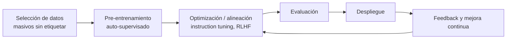
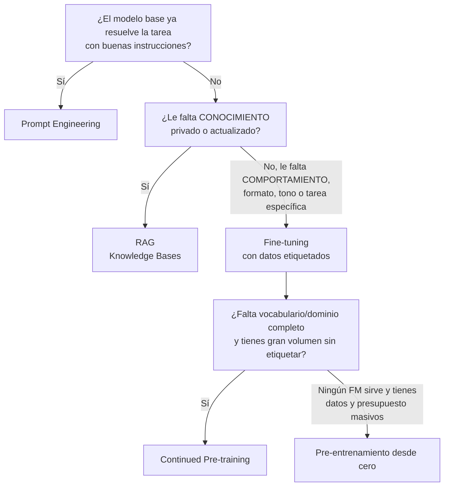

# Dominio 2 — Fundamentos de IA Generativa (24 %)

> **Peso en el examen:** 24 % (≈ 12 de las 50 preguntas que cuentan).
> **Objetivo:** entender cómo funcionan los Foundation Models, cómo se controla su salida en inferencia, qué técnica de adaptación elegir según costo/datos/complejidad y cuáles son sus limitaciones.
>
> 🆕 **Guía v1.1:** objetivos nuevos **2.1.4 precios por token**, **2.1.5 context engineering** y **2.1.6 IA agéntica y MCP**. Ver [novedades v1.1](../00-exam-guide-v1.1-changes.md#3-precios-basados-en-tokens-214).

## Mapeo a los task statements oficiales

| Task statement oficial | Sección |
|---|---|
| 2.1 Explicar los conceptos básicos de la IA generativa | [Arquitectura de FMs y LLMs](#1-arquitectura-de-foundation-models-y-llms), [Inferencia](#2-conceptos-de-inferencia) |
| 2.2 Comprender capacidades y limitaciones de la GenAI para resolver problemas de negocio | [Desafíos](#4-desafíos-y-limitaciones), [Valor de negocio](#5-valor-de-negocio-y-métricas) |
| 2.3 Describir la infraestructura y tecnologías de AWS para construir aplicaciones GenAI | [Adaptación](#3-técnicas-de-adaptación) y [Dominio 3](../03-applications-foundation-models/README.md) |

> **Nota:** en la guía oficial, *prompt engineering* y *fine-tuning* aparecen en los task statements 3.2 y 3.3. Aquí se presentan conceptualmente; la implementación en AWS está en el Dominio 3.

---

## 1. Arquitectura de Foundation Models y LLMs

### 1.1 Definiciones

| Término | Definición |
|---|---|
| **Foundation Model (FM)** | Modelo de gran escala pre-entrenado sobre datos masivos y diversos (mayormente sin etiquetar, mediante auto-supervisión) que puede adaptarse a **muchas tareas** distintas. |
| **Large Language Model (LLM)** | FM especializado en lenguaje (texto y código), normalmente basado en la arquitectura **Transformer** (*decoder-only*). |
| **Modelo multimodal** | Acepta y/o genera varias modalidades (texto, imagen, audio, video). |
| **Modelo de difusión** | Genera imágenes partiendo de ruido y "eliminándolo" iterativamente (p. ej., Stable Diffusion, Amazon Nova Canvas, Titan Image Generator). |
| **Embedding** | Vector numérico denso que representa el **significado semántico** de un texto/imagen. Textos similares → vectores cercanos (similitud coseno). Base de la búsqueda semántica y de RAG. |
| **Token** | Unidad mínima que procesa el modelo (palabra, sub-palabra o carácter). Regla aproximada en inglés: 1 token ≈ 4 caracteres ≈ 0,75 palabras (en español suele haber más tokens por palabra). |
| **Tokenización** | Conversión de texto en tokens (y luego en IDs numéricos). |
| **Parámetros** | Pesos del modelo; su número (miles de millones) es un indicador aproximado de capacidad y costo. |

### 1.2 Ciclo de vida de un Foundation Model



### 1.3 Transformer en 5 conceptos

```text
 Texto → [Tokenizer] → IDs → [Embeddings + codificación posicional]
       → [N bloques Transformer: Self-Attention + Feed-Forward]
       → [Capa de salida: distribución de probabilidad sobre el vocabulario]
       → Muestreo (temperatura / top-p / top-k) → siguiente token → (se repite)
```

1. **Self-attention:** cada token "mira" a todos los demás para capturar contexto y relaciones a larga distancia.
2. **Procesamiento paralelo:** a diferencia de las RNN, procesa la secuencia completa en paralelo durante el entrenamiento → escalabilidad.
3. **Codificación posicional:** inyecta el orden de los tokens.
4. **Generación autorregresiva:** el LLM genera **un token a la vez**, condicionado a todos los anteriores.
5. **Arquitecturas:** *encoder-only* (BERT, comprensión/clasificación/embeddings), *decoder-only* (GPT, Claude, Llama — generación), *encoder-decoder* (T5 — traducción/resumen).

### 1.4 Tipos de modelos generativos

| Tipo | Uso principal | Ejemplos en Amazon Bedrock |
|---|---|---|
| Texto-a-texto (LLM) | Chat, resumen, extracción, código | Anthropic Claude, Amazon Nova (Micro/Lite/Pro/Premier), Meta Llama, Mistral, AI21 Jamba, Cohere Command |
| Embeddings | Búsqueda semántica, RAG, clustering | Amazon Titan Text Embeddings V2, Cohere Embed |
| Texto-a-imagen | Generación/edición de imágenes | Amazon Nova Canvas, Amazon Titan Image Generator, Stability AI |
| Texto-a-video | Generación de video corto | Amazon Nova Reel |
| Voz-a-voz | Conversación por voz en tiempo real | Amazon Nova Sonic |

---

## 2. Conceptos de inferencia

### 2.1 Context window

La **ventana de contexto** es el número máximo de tokens que el modelo puede considerar en una petición (**prompt + historial + documentos recuperados + respuesta**).

- Superarla → error o truncamiento de la información más antigua.
- Ventanas más grandes permiten documentos largos, pero **aumentan costo y latencia** (se paga por token de entrada).
- Una ventana grande **no sustituye** a RAG cuando el corpus es mayor que la ventana o cambia con frecuencia.

### 2.2 Parámetros de inferencia

| Parámetro | Qué controla | Valor bajo | Valor alto | Uso recomendado |
|---|---|---|---|---|
| **Temperature** | Aleatoriedad del muestreo (aplana o agudiza la distribución de probabilidad). | Respuestas más deterministas y conservadoras. | Más creatividad/diversidad, mayor riesgo de incoherencia. | `0–0.3` extracción, clasificación, Q&A factual · `0.7–1.0` escritura creativa, brainstorming. |
| **Top-P** (*nucleus sampling*) | Considera el **conjunto mínimo de tokens cuya probabilidad acumulada ≥ P**. | Solo tokens muy probables. | Vocabulario más amplio. | `0.9` es un valor habitual. Ajusta temperatura **o** top-p, no ambos agresivamente. |
| **Top-K** | Considera solo los **K tokens más probables**. | Salida más predecible. | Más diversidad. | `K = 1` equivale a *greedy decoding*. |
| **Max tokens** (*max length*) | Longitud máxima de la respuesta. | Respuestas cortas, menor costo. | Respuestas largas. | Control directo del costo de salida. |
| **Stop sequences** | Cadena(s) que detienen la generación. | — | — | Forzar formatos (p. ej., detener en `</respuesta>`). |

```json
{
  "modelId": "amazon.nova-lite-v1:0",
  "messages": [{ "role": "user", "content": [{ "text": "Resume el siguiente contrato en 3 viñetas: ..." }] }],
  "inferenceConfig": {
    "maxTokens": 300,
    "temperature": 0.2,
    "topP": 0.9,
    "stopSequences": ["###"]
  }
}
```

> Parámetros de la **Converse API** de Amazon Bedrock, la interfaz unificada para todos los modelos de chat (en boto3: `bedrock_runtime.converse(**params)`). `topK` no forma parte de `inferenceConfig`; se envía, cuando el modelo lo soporta, vía `additionalModelRequestFields`.

### 2.3 Prompt engineering (fundamentos)

| Técnica | Descripción | Cuándo usarla |
|---|---|---|
| **Zero-shot** | Solo la instrucción, sin ejemplos. | Tareas simples y bien conocidas. |
| **One-shot / Few-shot** | Se incluyen 1 o varios ejemplos entrada→salida en el prompt. | Forzar formato o estilo concreto sin entrenar el modelo. |
| **Chain-of-Thought (CoT)** | Se pide razonar paso a paso. | Problemas de lógica, matemáticas, decisiones multi-paso. |
| **Role / System prompt** | Se asigna un rol y reglas ("Eres un analista financiero…"). | Controlar tono, alcance y restricciones. |
| **Prompt templates** | Plantillas reutilizables con variables. | Estandarizar y versionar prompts (Bedrock Prompt Management). |
| **Negative prompting** | Indicar lo que **no** debe aparecer. | Generación de imágenes, exclusión de temas. |
| **Delimitadores / estructura** | Separar instrucciones, contexto y datos con etiquetas (`<documento>`). | Reducir ambigüedad y mitigar *prompt injection*. |

**Anatomía de un buen prompt:** instrucción clara · contexto · datos de entrada · formato de salida esperado · restricciones.

---

## 3. Técnicas de adaptación



### 3.1 Tabla comparativa

| Criterio | Prompt Engineering | RAG | Fine-tuning (instrucciones) | Continued Pre-training | Pre-entrenamiento desde cero |
|---|---|---|---|---|---|
| **Qué cambia** | Solo la entrada | La entrada (se añade contexto recuperado) | Los **pesos** del modelo | Los **pesos** del modelo | Todo: se crea un modelo nuevo |
| **Datos requeridos** | Ninguno o pocos ejemplos | Corpus de documentos **sin etiquetar** (indexados como embeddings) | Pares **prompt–respuesta etiquetados** (cientos a miles) | Gran volumen de texto de dominio **sin etiquetar** | Billones de tokens (TB de datos) |
| **Costo** | 💲 Muy bajo | 💲💲 Bajo–medio (embeddings + vector store + tokens extra) | 💲💲💲 Medio–alto (entrenamiento + alojamiento del modelo personalizado) | 💲💲💲💲 Alto | 💲💲💲💲💲 Extremo (millones USD, clusters de GPU) |
| **Complejidad** | Baja | Media | Media–alta | Alta | Muy alta |
| **Tiempo hasta valor** | Minutos | Horas–días | Días–semanas | Semanas | Meses |
| **Información actualizada** | No (solo lo que pongas en el prompt) | ✅ Sí: re-sincronizas la fuente | ❌ Se congela en el entrenamiento | ❌ Se congela | ❌ Se congela |
| **Reduce alucinaciones** | Parcialmente | ✅ Sí, ancla la respuesta en fuentes y permite **citas** | Parcialmente | Parcialmente | Depende |
| **Ideal para** | Formato, tono, tareas genéricas | Q&A sobre documentación interna, soporte, políticas | Estilo de marca, tarea muy específica, formato estricto, clasificación | Vocabulario especializado (médico, legal, financiero) | Proveedores de modelos / casos únicos |
| **Soporte en AWS** | Bedrock, Prompt Management | **Bedrock Knowledge Bases**, Amazon Kendra, OpenSearch | **Bedrock Custom Models** (fine-tuning), SageMaker JumpStart | Bedrock (continued pre-training), SageMaker AI | SageMaker HyperPod, EC2 Trn/P-instances |

> **Regla de oro del examen:** *¿conocimiento privado/cambiante?* → **RAG**. *¿comportamiento, estilo o tarea especializada?* → **Fine-tuning**. *¿la opción más barata y rápida?* → **Prompt engineering**.

### 3.2 Otras técnicas a reconocer

| Técnica | Descripción |
|---|---|
| **Instruction tuning** | Fine-tuning con instrucciones y respuestas para que el modelo siga órdenes. |
| **RLHF** | Alinear el modelo a preferencias humanas mediante un modelo de recompensa. |
| **Domain adaptation** | Adaptar un FM a un dominio concreto (equivale a continued pre-training). |
| **Transfer learning** | Reutilizar un modelo pre-entrenado y ajustarlo a una nueva tarea. Es el principio detrás del fine-tuning. |
| **Model distillation** | Entrenar un modelo "estudiante" pequeño con las respuestas de un modelo "maestro" grande → menor costo y latencia (Bedrock Model Distillation). |
| **PEFT / LoRA** | Fine-tuning eficiente que entrena solo una pequeña fracción de parámetros. |

### 3.3 Preparación de datos para fine-tuning

- Datos **curados**, representativos, sin PII innecesaria, con licencia de uso.
- Formato típico en Bedrock: JSON Lines (`.jsonl`) en Amazon S3.

```json
{"prompt": "Clasifica el ticket: 'No puedo iniciar sesión en la app móvil'", "completion": "categoria: autenticacion"}
{"prompt": "Clasifica el ticket: 'Me cobraron dos veces este mes'", "completion": "categoria: facturacion"}
```

---

## 4. Desafíos y limitaciones

| Desafío | Descripción | Mitigaciones (y servicio AWS) |
|---|---|---|
| **Alucinaciones** | Respuestas fluidas y convincentes pero **falsas** o no respaldadas. | RAG con citas (Bedrock Knowledge Bases), *contextual grounding check* y *automated reasoning checks* de **Bedrock Guardrails**, temperatura baja, instrucción "si no sabes, dilo", revisión humana (Amazon A2I). |
| **Sesgo (bias)** | Reproduce o amplifica sesgos de los datos de entrenamiento. | Datos diversos y balanceados, evaluación de sesgo (SageMaker Clarify, Bedrock Model Evaluation), revisión humana. |
| **Toxicidad / contenido dañino** | Contenido ofensivo, violento, inapropiado. | Filtros de contenido de **Bedrock Guardrails**. |
| **Fuga de datos (data leakage)** | Exposición de PII o datos confidenciales en prompts, logs o respuestas; memorización de datos de entrenamiento. | Filtros de información sensible (PII) en Guardrails, Amazon Macie sobre S3, minimización de datos, cifrado con KMS, IAM de mínimo privilegio. |
| **Prompt injection / jailbreak** | Entradas maliciosas que intentan anular las instrucciones del sistema. | Filtro *prompt attack* de Guardrails, separación de instrucciones y datos, validación de entradas, mínimo privilegio en herramientas de agentes. |
| **Degradación del modelo / drift** | El mundo cambia y el conocimiento del modelo queda desactualizado (*knowledge cutoff*); en ML clásico, la distribución de datos cambia. | RAG con sincronización periódica, evaluación continua, Model Monitor (SageMaker), re-entrenamiento. |
| **No determinismo** | La misma entrada puede producir salidas distintas. | Temperatura baja, prompts estructurados, validación de formato. |
| **Interpretabilidad** | Difícil explicar por qué el modelo generó una salida. | Citas de fuentes (RAG), trazas de agentes, Model Cards. |
| **Propiedad intelectual** | Riesgo de generar contenido protegido. | Modelos con indemnización del proveedor, filtros, revisión legal. |
| **Costo y latencia** | Tokens y modelos grandes encarecen y ralentizan. | Elegir el modelo más pequeño que cumpla, *prompt caching*, *batch inference*, distilación. |

---

## 5. Valor de negocio y métricas

### 5.1 Ventajas de la GenAI

Adaptabilidad (un modelo, muchas tareas) · velocidad de desarrollo · escalabilidad · personalización · automatización de tareas de conocimiento.

### 5.2 Métricas de evaluación de modelos generativos

| Métrica | Mide | Uso típico |
|---|---|---|
| **ROUGE** | Solapamiento (recall) de n-gramas entre la salida y una referencia. | **Resumen** de textos. |
| **BLEU** | Precisión de n-gramas frente a traducciones de referencia. | **Traducción** automática. |
| **BERTScore** | Similitud **semántica** usando embeddings (no solo coincidencia literal). | Evaluar paráfrasis y equivalencia de significado. |
| **Perplexity** | Qué tan "sorprendido" está el modelo ante un texto (menor = mejor). | Calidad del modelado de lenguaje. |
| **Evaluación humana** | Calidad, relevancia, tono, utilidad juzgados por personas. | Aspectos subjetivos (Bedrock Model Evaluation con equipo humano). |
| **LLM-as-a-judge** | Un LLM evalúa las respuestas de otro según criterios. | Evaluación a escala de corrección, completitud, nocividad. |

### 5.3 Métricas de negocio para GenAI

Eficiencia operativa, tasa de resolución en el primer contacto, conversión, *average revenue per user*, CSAT, costo por interacción, tiempo ahorrado por empleado.

---

## Autoevaluación rápida

- [ ] Explico qué es un token, un embedding y la ventana de contexto.
- [ ] Sé el efecto de subir/bajar temperatura, top-p y top-k.
- [ ] Elijo entre prompt engineering, RAG, fine-tuning y pre-entrenamiento según datos, costo y frescura.
- [ ] Asocio ROUGE → resumen, BLEU → traducción, BERTScore → similitud semántica.
- [ ] Propongo una mitigación AWS para alucinaciones, sesgo, fuga de datos y prompt injection.

⬅️ Anterior: [Dominio 1](../01-fundamentals-ai-ml/README.md) · ➡️ Siguiente: [Dominio 3 — Aplicaciones de Modelos Fundacionales](../03-applications-foundation-models/README.md)
