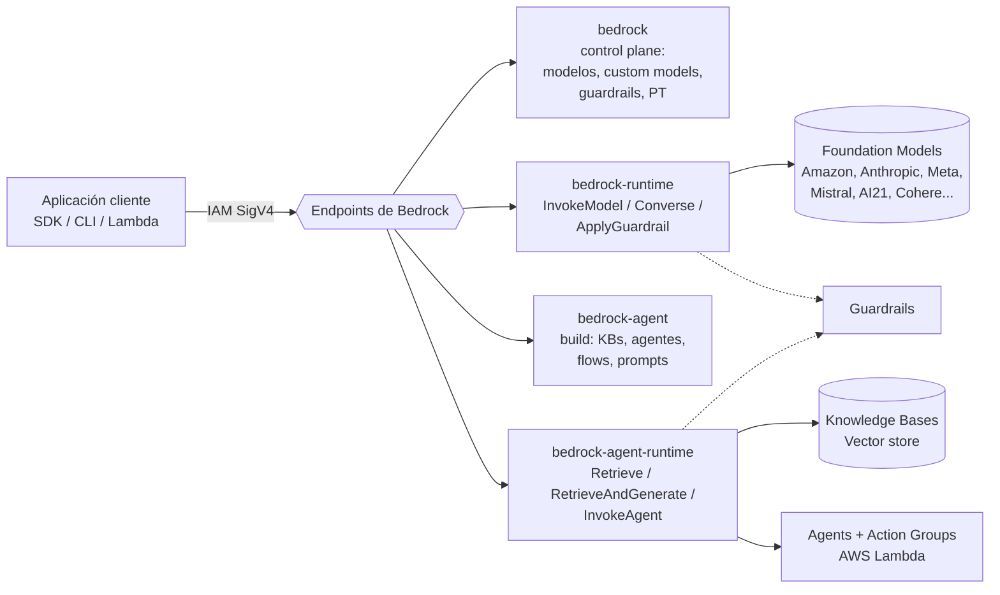
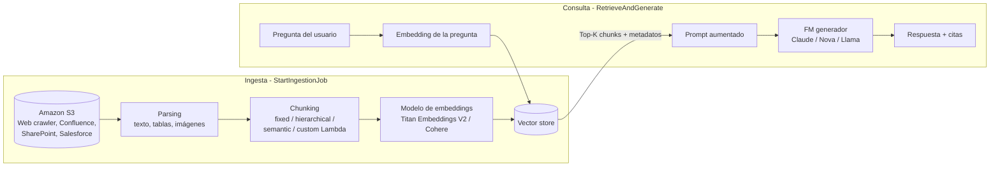
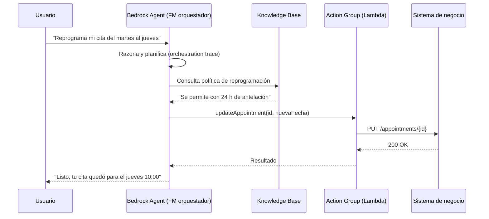
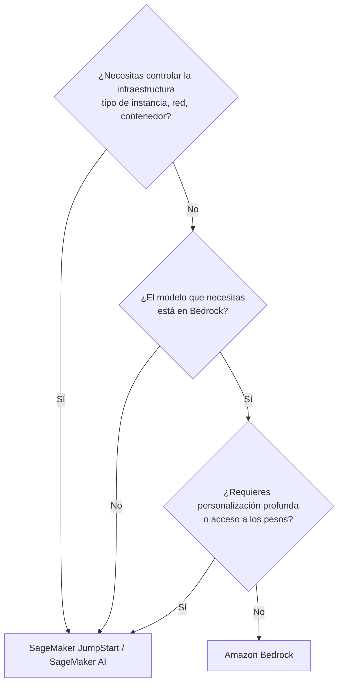

# Dominio 3 — Aplicaciones de Modelos Fundacionales en AWS (28 %)

> **Peso en el examen:** 28 % — **el dominio más importante** (≈ 14 de las 50 preguntas que cuentan).
> **Objetivo:** saber diseñar soluciones con Amazon Bedrock (modelos, Knowledge Bases, Agents, Guardrails), decidir entre Bedrock y SageMaker JumpStart, y elegir el servicio de IA aplicada correcto para cada caso de uso.
>
> 🆕 **Guía v1.1:** objetivos nuevos **3.2.5 versionado de prompts (Prompt Management)** y **3.4.5 métricas de negocio**; *distillation* y *LLM-as-a-judge* añadidos; servicios nuevos **AgentCore, Strands Agents, Kiro, AWS Transform** y Amazon Quick. Ver [novedades v1.1](../00-exam-guide-v1.1-changes.md#55-servicios-y-herramientas-agénticas-de-aws).

## Mapeo a los task statements oficiales

| Task statement oficial | Sección |
|---|---|
| 3.1 Consideraciones de diseño para aplicaciones que usan FMs | [Amazon Bedrock](#1-amazon-bedrock), [Selección de modelos](#13-selección-de-modelos), [Bedrock vs. JumpStart](#2-amazon-sagemaker-jumpstart-y-criterios-de-decisión) |
| 3.2 Técnicas efectivas de prompt engineering | [Prompt engineering en AWS](#4-prompt-engineering-en-aws-y-riesgos) |
| 3.3 Proceso de entrenamiento y fine-tuning de FMs | [Personalización de modelos](#17-personalización-de-modelos-custom-models) |
| 3.4 Métodos para evaluar el desempeño de FMs | [Evaluación de modelos](#5-evaluación-de-foundation-models) |

---

## 1. Amazon Bedrock

**Amazon Bedrock** es un servicio **serverless y totalmente gestionado** que expone, mediante una API unificada, Foundation Models de Amazon y de proveedores terceros, junto con herramientas para construir aplicaciones GenAI (RAG, agentes, guardrails, evaluación, personalización).

**Propiedades clave para el examen:**

- **Sin infraestructura que gestionar:** no eliges instancias ni GPUs; pagas por uso (tokens) o por capacidad reservada.
- **Privacidad:** tus prompts y respuestas **no se usan para entrenar** los modelos base y **no se comparten** con los proveedores de modelos. Los modelos se ejecutan en cuentas de despliegue operadas por AWS a las que los proveedores no tienen acceso.
- **Datos en la región:** el contenido permanece en la región donde usas el servicio (salvo que habilites explícitamente *cross-region inference*).
- **Cifrado** en tránsito (TLS) y en reposo (con claves de AWS KMS gestionadas por AWS o por el cliente).
- **Cumplimiento:** dentro del alcance de programas como ISO, SOC, CSA STAR, GDPR y elegible para HIPAA (verifica el alcance vigente en AWS Artifact).

### 1.1 Arquitectura lógica



| Endpoint / prefijo IAM | Propósito |
|---|---|
| `bedrock` | Plano de control: listar modelos, crear guardrails, trabajos de personalización, Provisioned Throughput, logging. |
| `bedrock-runtime` | Inferencia: `InvokeModel`, `InvokeModelWithResponseStream`, `Converse`, `ConverseStream`, `ApplyGuardrail`, batch. |
| `bedrock-agent` | Construcción de Knowledge Bases, data sources, agentes, flows y prompts. |
| `bedrock-agent-runtime` | Ejecución: `Retrieve`, `RetrieveAndGenerate`, `InvokeAgent`, `InvokeFlow`. |

### 1.2 Primeros pasos con la CLI

```bash
# Listar modelos de texto disponibles de un proveedor en la región
aws bedrock list-foundation-models \
  --by-provider anthropic \
  --by-output-modality TEXT \
  --query 'modelSummaries[].modelId' --output table

# Inferencia con la Converse API (interfaz común a todos los modelos de chat)
aws bedrock-runtime converse \
  --model-id amazon.nova-lite-v1:0 \
  --messages '[{"role":"user","content":[{"text":"Explica RAG en 2 frases."}]}]' \
  --inference-config '{"maxTokens":200,"temperature":0.2}'
```

> Algunos modelos solo están disponibles a través de **inference profiles** (*cross-region inference*), cuyo identificador lleva prefijo geográfico, p. ej. `us.anthropic.<modelo>`. Consulta `aws bedrock list-inference-profiles`.

### 1.3 Selección de modelos

| Proveedor / familia | Fortalezas | Casos de uso típicos |
|---|---|---|
| **Anthropic Claude** | Razonamiento complejo, contexto largo, código, uso de herramientas (agentes), visión, fuerte enfoque en seguridad. | Asistentes empresariales, análisis de documentos extensos, agentes, generación de código. |
| **Amazon Nova** (Micro, Lite, Pro, Premier; Canvas, Reel, Sonic) | Excelente relación costo/latencia, multimodal (texto, imagen, video), integración nativa con AWS. | Alto volumen y bajo costo, comprensión de documentos/video, generación de imagen (Canvas) y video (Reel), voz (Sonic). |
| **Amazon Titan** | **Embeddings** (Titan Text Embeddings V2, Multimodal Embeddings), generación de imágenes con marca de agua invisible. | Vectorización para RAG y búsqueda semántica; generación de imágenes. |
| **Meta Llama** | Pesos abiertos, buena base para personalización, multilingüe. | Fine-tuning, cargas que exigen portabilidad del modelo. |
| **Mistral AI** | Modelos eficientes, buen rendimiento/costo, multilingüe (europeo). | Resumen, clasificación, razonamiento ligero. |
| **AI21 Labs** (Jurassic-2 → **Jamba**) | Jurassic-2 es **legado** (retirado de Bedrock); su sucesor Jamba ofrece ventana de contexto muy larga (256K). | Generación y resumen de documentos largos. Si el examen menciona *Jurassic*, piensa en "LLM de AI21 para generación de texto". |
| **Cohere** (Command, Embed, Rerank) | Embeddings multilingües y **reranking** para mejorar la recuperación. | Búsqueda empresarial, RAG multilingüe. |
| **Stability AI** | Generación de imágenes de alta calidad (difusión). | Marketing, diseño, prototipado visual. |
| Otros (DeepSeek, Qwen, modelos open-weight de OpenAI, etc.) | Variedad de modelos de razonamiento y pesos abiertos. | Experimentación y comparación costo/calidad. |

**Criterios de selección (pregunta frecuente):**

1. **Modalidad** de entrada/salida (texto, imagen, video, embeddings).
2. **Calidad** en *tu* tarea (mídela con Bedrock Model Evaluation, no con benchmarks genéricos).
3. **Latencia** y **costo** por 1 000 tokens de entrada/salida.
4. **Ventana de contexto** necesaria.
5. **Idiomas** soportados.
6. **Personalización**: ¿el modelo admite fine-tuning en Bedrock?
7. **Disponibilidad regional** y requisitos de cumplimiento/residencia.
8. **Licencia** y términos de uso del proveedor.

> **Principio práctico:** empieza con el **modelo más pequeño y barato** que cumpla el umbral de calidad; escala solo si la evaluación lo justifica.

### 1.4 Amazon Bedrock Knowledge Bases (RAG gestionado)

Implementa el flujo RAG completo — ingesta, *chunking*, embeddings, almacenamiento vectorial, recuperación y generación con citas — **sin escribir el pipeline a mano**.



| Componente | Opciones |
|---|---|
| **Fuentes de datos** | Amazon S3, Web Crawler, Confluence, SharePoint, Salesforce, conector personalizado (ingesta directa vía API). Datos estructurados: Amazon Redshift (consultas en lenguaje natural → SQL). |
| **Estrategia de chunking** | *Fixed-size* (tamaño + solapamiento), por defecto (~300 tokens), *hierarchical* (chunks padre/hijo), *semantic* (por significado), sin chunking, o personalizada con AWS Lambda. |
| **Parsing** | Parser por defecto (texto), **Bedrock Data Automation** o un FM como parser (para PDFs con tablas e imágenes). |
| **Modelos de embeddings** | Amazon Titan Text Embeddings V2, Titan Multimodal Embeddings, Cohere Embed. |
| **Vector stores** | **Amazon OpenSearch Serverless** (opción "quick create"), Amazon OpenSearch Service (managed clusters), **Amazon Aurora PostgreSQL** (pgvector), **Amazon S3 Vectors** (bajo costo), **Amazon Neptune Analytics** (GraphRAG), **Pinecone**, **Redis Enterprise Cloud**, **MongoDB Atlas**. |
| **APIs** | `Retrieve` (solo devuelve chunks; tú construyes el prompt) · `RetrieveAndGenerate` (recupera + genera respuesta con citas, gestiona sesión). |
| **Mejoras de recuperación** | Filtros por metadatos, *reranking* (modelos de reranking), descomposición de consultas, búsqueda híbrida (semántica + palabra clave en OpenSearch). |

**Cuándo elegir cada vector store (nivel examen):**

| Si necesitas… | Elige |
|---|---|
| La opción por defecto, totalmente gestionada y serverless, con búsqueda híbrida | **OpenSearch Serverless** |
| Reutilizar una base relacional existente / SQL + vectores | **Aurora PostgreSQL (pgvector)** |
| El menor costo de almacenamiento para grandes volúmenes con consultas poco frecuentes | **Amazon S3 Vectors** |
| Relaciones entre entidades (grafos de conocimiento) | **Neptune Analytics (GraphRAG)** |
| Un proveedor vectorial SaaS que la organización ya usa | **Pinecone / MongoDB Atlas / Redis Enterprise Cloud** |

> Laboratorio práctico: [Lab 01 — Pipeline RAG con Bedrock Knowledge Bases, S3 y OpenSearch Serverless](../../labs/lab-01-rag-bedrock-knowledge-bases/README.md).

### 1.5 Amazon Bedrock Agents

Un **agente** usa un FM para **razonar, planificar y ejecutar acciones multi-paso** invocando APIs y consultando Knowledge Bases (patrón ReAct: *Reason + Act*).



| Componente | Función |
|---|---|
| **Instrucciones** | Prompt que define el rol y el objetivo del agente. |
| **Action groups** | Acciones que el agente puede invocar, definidas mediante un **esquema OpenAPI** o *function details*, ejecutadas por **AWS Lambda** o devueltas a la aplicación (*return of control*). |
| **Knowledge Bases asociadas** | Fuente de conocimiento para RAG dentro del agente. |
| **Memoria** | Retención del contexto entre sesiones (resumen de sesión). |
| **Guardrails** | Políticas de seguridad aplicadas a entradas y salidas del agente. |
| **Trace** | Visibilidad paso a paso del razonamiento (útil para depuración y auditoría). |
| **Versiones y aliases** | Despliegue controlado de versiones inmutables. |
| **Multi-agent collaboration** | Un agente supervisor coordina agentes especializados. |
| **Code interpretation** | El agente puede generar y ejecutar código en un sandbox. |

> **Amazon Bedrock AgentCore** ofrece servicios modulares (Runtime, Memory, Gateway, Identity, Observability, herramientas de navegador e intérprete de código) para operar en producción agentes construidos con **cualquier framework** (Strands Agents, LangGraph, CrewAI…) y cualquier modelo. *Bedrock Agents* es la opción gestionada y configurable; *AgentCore* da más control para agentes a escala.

**Bedrock Flows** (orquestación visual de prompts, KBs, agentes y Lambda en flujos de trabajo) y **Prompt Management** (versionado de prompts) completan las herramientas de construcción.

### 1.6 Amazon Bedrock Guardrails

Políticas configurables de **IA responsable** que se aplican a la **entrada del usuario y a la respuesta del modelo**, independientemente del FM. Con la API `ApplyGuardrail` también pueden aplicarse a modelos **fuera de Bedrock** (SageMaker, otros proveedores, modelos propios).

| Política | Qué hace | Ejemplo |
|---|---|---|
| **Content filters** | Detecta y bloquea categorías dañinas con umbral configurable: *Hate, Insults, Sexual, Violence, Misconduct* y **Prompt Attack** (jailbreak / prompt injection). También para imágenes. | Bloquear insultos en un chatbot público. |
| **Denied topics** | Temas prohibidos definidos en lenguaje natural. | "No dar asesoría de inversión" en un banco. |
| **Word filters** | Lista de palabras/frases bloqueadas + filtro de lenguaje soez gestionado. | Nombres de competidores. |
| **Sensitive information filters** | Detecta **PII** (correo, teléfono, SSN, tarjeta de crédito…) y patrones **regex** propios; acción **BLOCK** o **MASK** (anonimizar). | Enmascarar números de tarjeta en la respuesta. |
| **Contextual grounding check** | Verifica que la respuesta esté **fundamentada en la fuente** y sea **relevante** a la pregunta (umbrales). | Detectar alucinaciones en RAG. |
| **Automated Reasoning checks** | Valida matemáticamente la respuesta contra políticas formales definidas a partir de documentos. | Verificar elegibilidad según una política de RR. HH. |

```python
import boto3

bedrock = boto3.client("bedrock-runtime", region_name="us-east-1")

response = bedrock.converse(
    modelId="amazon.nova-lite-v1:0",
    messages=[{"role": "user", "content": [{"text": "¿En qué acciones debería invertir?"}]}],
    guardrailConfig={
        "guardrailIdentifier": "gr-abc123example",  # ID o ARN del guardrail
        "guardrailVersion": "1",
        "trace": "enabled",
    },
)

# stopReason == "guardrail_intervened" cuando el guardrail bloquea la interacción
print(response["stopReason"])
print(response["output"]["message"]["content"][0]["text"])
```

> **Gobernanza:** puedes **obligar** el uso de un guardrail concreto con la condición IAM `bedrock:GuardrailIdentifier` (ver [Dominio 5](../05-security-compliance-governance/README.md#22-forzar-guardrails-con-iam)).

### 1.7 Personalización de modelos (Custom Models)

| Método en Bedrock | Datos | Resultado |
|---|---|---|
| **Fine-tuning** | Pares prompt–completion **etiquetados** (JSONL en S3). | Modelo ajustado a una tarea/estilo. |
| **Continued pre-training** | Texto de dominio **sin etiquetar**. | Modelo con mayor conocimiento de dominio. |
| **Model distillation** | Prompts; las respuestas las genera un modelo "maestro". | Modelo "estudiante" más pequeño, rápido y barato con calidad cercana al maestro. |
| **Custom Model Import** | Pesos de un modelo propio de arquitectura soportada (p. ej., Llama, Mistral). | Modelo propio servido de forma serverless en Bedrock. |

Puntos de examen:

- Los datos de entrenamiento y validación se leen desde **Amazon S3**; el job asume un **rol de servicio IAM**; los artefactos pueden cifrarse con **KMS** y el tráfico puede restringirse a una **VPC**.
- El modelo personalizado es **privado** de tu cuenta: ni AWS ni el proveedor del modelo base lo usan.
- Para invocar modelos personalizados se ha usado tradicionalmente **Provisioned Throughput** (ver costos en el [Dominio 5](../05-security-compliance-governance/README.md#5-optimización-de-costos-en-bedrock)); algunos modelos ya admiten despliegue bajo demanda.
- Hiperparámetros típicos: *epochs*, *batch size*, *learning rate*.

---

## 2. Amazon SageMaker JumpStart y criterios de decisión

**SageMaker JumpStart** es el *hub* de modelos de **Amazon SageMaker AI**: cientos de modelos pre-entrenados (FMs y modelos clásicos) y soluciones de ejemplo que se despliegan con pocos clics **en endpoints de SageMaker dentro de tu cuenta**, sobre las instancias que elijas.

### 2.1 Bedrock vs. SageMaker JumpStart

| Criterio | Amazon Bedrock | SageMaker JumpStart |
|---|---|---|
| **Modelo operativo** | Serverless, API gestionada | Endpoints sobre instancias que **tú** dimensionas y gestionas |
| **Control de infraestructura** | Ninguno (no eliges hardware) | **Total**: tipo de instancia (GPU), autoescalado, VPC, aislamiento de red |
| **Personalización** | Fine-tuning, continued pre-training, distilación (modelos soportados) | **Profunda**: acceso a scripts de entrenamiento, hiperparámetros completos, cualquier técnica |
| **Catálogo** | Selección curada de FMs de primer nivel | Catálogo amplio, incluidos muchos modelos open-source y de nicho |
| **Acceso a los pesos del modelo** | No (salvo modelos importados) | Sí, para modelos open-weight |
| **Modelo de precios** | Por token (On-Demand / Batch) o Provisioned Throughput | Por hora de instancia (pagas aunque no haya tráfico, salvo serverless/async con escala a cero) |
| **Esfuerzo operativo** | Mínimo | Mayor (MLOps, escalado, parches del contenedor) |
| **Funcionalidades GenAI integradas** | Knowledge Bases, Agents, Guardrails, Evaluation, Flows | Las construyes tú (o combinas con Bedrock vía `ApplyGuardrail`) |
| **Perfil típico** | Desarrolladores de aplicaciones que quieren rapidez | Equipos de data science/ML que necesitan control |



> **Pista de examen:** "*menor esfuerzo operativo*", "*serverless*", "*sin gestionar infraestructura*" → **Bedrock**. "*control total*", "*elegir el tipo de instancia*", "*modelo open-source específico*", "*personalización profunda*" → **SageMaker JumpStart**. *Bedrock Marketplace* permite usar ciertos modelos adicionales a través de las APIs de Bedrock desplegándolos en endpoints gestionados.

---

## 3. Servicios de IA aplicada de AWS

Servicios **pre-entrenados**, consumibles por API, que **no requieren experiencia en ML**. En el examen, si el caso de uso encaja exactamente con uno de ellos, suele ser la respuesta de **menor esfuerzo**.

### 3.1 NLP y Visión

| Servicio | Capacidades clave | Detalles a recordar |
|---|---|---|
| **Amazon Comprehend** | NLP: sentimiento, entidades, frases clave, idioma, sintaxis, **detección/redacción de PII**, *topic modeling*, clasificación y reconocimiento de entidades **personalizados**. | **Comprehend Medical** para texto clínico (PHI, medicamentos, diagnósticos). |
| **Amazon Rekognition** | Visión en imágenes y video: objetos, escenas, rostros (detección, comparación, búsqueda), celebridades, **moderación de contenido**, texto en imágenes, EPP, *Custom Labels*. | Video en streaming y almacenado; *Face Liveness* para verificación de identidad. |
| **Amazon Textract** | Extracción de **texto, formularios (clave-valor), tablas** y firmas de documentos escaneados; *Queries* en lenguaje natural; APIs especializadas para facturas/recibos (*AnalyzeExpense*), documentos de identidad (*AnalyzeID*) y préstamos. | Va **más allá del OCR**: entiende la estructura del documento. |

### 3.2 Voz y Conversación

| Servicio | Capacidades clave | Detalles a recordar |
|---|---|---|
| **Amazon Polly** | **Text-to-Speech**: voces neuronales y generativas, múltiples idiomas, **SSML** (pausas, énfasis, pronunciación), léxicos, *speech marks*. | Texto → audio. |
| **Amazon Transcribe** | **Speech-to-Text**: transcripción por lotes y en streaming, identificación de hablantes (*diarization*), vocabulario personalizado, **redacción de PII**, identificación de idioma. | *Call Analytics* para centros de contacto; *Transcribe Medical*. |
| **Amazon Lex** | **Chatbots** de voz y texto: intents, slots, fulfillment con Lambda; integración con Amazon Connect; funciones asistidas por GenAI. | Misma tecnología de ASR/NLU que Alexa. |

### 3.3 Productividad y Datos (Amazon Q)

| Servicio | Para quién | Capacidades clave |
|---|---|---|
| **Amazon Q Developer** (antes *CodeWhisperer*) | Desarrolladores y equipos de operaciones | Generación y explicación de código en IDE y CLI, **escaneo de seguridad**, generación de tests, **transformación de código** (p. ej., actualizar versiones de Java, migrar .NET), asistencia en la consola de AWS (diagnóstico de errores, recomendaciones). |
| **Amazon Q Business** | Empleados de la empresa | Asistente GenAI sobre **datos corporativos** mediante conectores (S3, SharePoint, Confluence, Salesforce…), **respeta los permisos (ACL) de la fuente**, se integra con IAM Identity Center, admite guardrails administrativos y **Q Apps** (mini-apps sin código). |
| **Amazon Q in QuickSight** | Analistas y usuarios de negocio | **BI conversacional**: preguntas en lenguaje natural sobre los datos, construcción de visuales y dashboards, resúmenes ejecutivos y *data stories*. |

> QuickSight evolucionó a **Amazon Quick** (antes *Amazon Quick Suite*): Quick Sight (BI), Quick Research, Quick Flows, Quick Automate y Quick Index. La guía v1.1 ya menciona **Amazon Quick**; el material antiguo puede usar "Amazon Q in QuickSight" o "QuickSight Q". Ver [novedades v1.1](../00-exam-guide-v1.1-changes.md#55-servicios-y-herramientas-agénticas-de-aws).

### 3.4 Otros servicios que aparecen en el examen

| Servicio | Caso de uso |
|---|---|
| **Amazon Translate** | Traducción automática neuronal (con terminología personalizada). |
| **Amazon Kendra** | **Búsqueda empresarial inteligente** sobre documentos (también usable como retriever para RAG). |
| **Amazon Personalize** | Recomendaciones personalizadas en tiempo real (misma tecnología que Amazon.com). |
| **Amazon Augmented AI (A2I)** | **Revisión humana** de predicciones de baja confianza (Textract, Rekognition, modelos propios). |
| **Bedrock Data Automation** | Extracción de información de documentos, imágenes, audio y video con GenAI (IDP multimodal). |

### 3.5 Tabla resumen: Servicio | Caso de uso principal | Cuándo NO usarlo

| Servicio | Caso de uso principal | Cuándo NO usarlo |
|---|---|---|
| **Amazon Bedrock** | Construir aplicaciones GenAI (chat, resumen, RAG, agentes) con FMs serverless. | Cuando necesitas control total de la infraestructura/pesos o un modelo no disponible → SageMaker AI. Para una tarea de NLP/visión estándar ya cubierta por un servicio de IA específico (más barato y simple). |
| **SageMaker JumpStart** | Desplegar y personalizar a fondo modelos pre-entrenados en tu propia infraestructura gestionada. | Si buscas el menor esfuerzo operativo y pago por token → Bedrock. |
| **Amazon Comprehend** | Sentimiento, entidades, PII y clasificación de **texto**. | Para extraer texto de documentos escaneados (→ Textract) o generar texto nuevo (→ Bedrock). |
| **Amazon Rekognition** | Análisis de **imágenes/video**: objetos, rostros, moderación. | Para extraer **formularios y tablas** de documentos (→ Textract). Para generar imágenes (→ Bedrock/Nova Canvas). |
| **Amazon Textract** | Extraer texto, formularios y tablas de documentos escaneados/PDF. | Para analizar el *sentimiento* del texto extraído (→ Comprehend, en cadena). Para detectar objetos en fotos (→ Rekognition). |
| **Amazon Polly** | Convertir **texto en voz**. | Para transcribir audio a texto (→ Transcribe). |
| **Amazon Transcribe** | Convertir **voz en texto** (llamadas, reuniones, subtítulos). | Para generar audio (→ Polly) o entender intents de una conversación (→ Lex). |
| **Amazon Lex** | Chatbots/IVR basados en intents y slots. | Para preguntas abiertas sobre miles de documentos internos (→ Q Business o Bedrock + Knowledge Bases). |
| **Amazon Q Developer** | Asistente de código y de operaciones en AWS. | Para un asistente de empleados sobre datos de RR. HH./ventas (→ Q Business). |
| **Amazon Q Business** | Asistente empresarial listo para usar sobre datos corporativos, respetando permisos. | Para una aplicación GenAI de cara al cliente totalmente personalizada (→ Bedrock). |
| **Amazon Q in QuickSight** | Preguntas en lenguaje natural sobre datos de BI y dashboards. | Para Q&A sobre documentos no estructurados (→ Q Business / Bedrock KB). |
| **Amazon Translate** | Traducción de texto. | Para traducir audio directamente (combina Transcribe → Translate → Polly). |
| **Amazon Kendra** | Búsqueda semántica empresarial. | Para generar respuestas redactadas (combínalo con Bedrock o usa Q Business). |
| **Amazon Personalize** | Recomendaciones de productos/contenido. | Para pronóstico de series de tiempo o clasificación genérica. |

### 3.6 Patrones de composición frecuentes

```text
Documento escaneado ──► Textract ──► Comprehend (entidades/PII) ──► S3 / búsqueda
Llamada de soporte  ──► Transcribe ──► Comprehend (sentimiento) ──► QuickSight
Audio en inglés     ──► Transcribe ──► Translate (es) ──► Polly (voz en español)
Imagen subida       ──► Rekognition (moderación) ──► A2I (revisión humana si baja confianza)
Pregunta de cliente ──► Lex ──► Lambda ──► Bedrock Knowledge Base ──► respuesta
```

---

## 4. Prompt engineering en AWS y riesgos

- **Bedrock Prompt Management:** crear, versionar y probar plantillas de prompt con variables y compararlas entre modelos.
- **Bedrock Playground / PartyRock:** experimentación sin código (PartyRock es un entorno educativo para crear apps GenAI).
- Buenas prácticas: ser específico, dar contexto, indicar el formato de salida, usar ejemplos (few-shot), delimitar datos, pedir razonamiento paso a paso cuando aplique, iterar y evaluar.

| Riesgo de prompt | Descripción | Mitigación |
|---|---|---|
| **Prompt injection** | Instrucciones maliciosas en la entrada (o en documentos recuperados) que alteran el comportamiento. | Guardrails (Prompt Attack), separación instrucciones/datos, mínimo privilegio en las herramientas. |
| **Jailbreaking** | Intentos de evadir las restricciones de seguridad del modelo. | Guardrails, system prompts robustos, monitoreo. |
| **Prompt leaking** | Lograr que el modelo revele su system prompt o datos internos. | No incluir secretos en prompts, filtros de salida. |
| **Poisoning** | Datos maliciosos introducidos en el entrenamiento o en la base de conocimiento. | Control de acceso y validación de las fuentes de datos, linaje. |
| **Hijacking** | Desviar el modelo a tareas no previstas. | Denied topics, validación de intents. |

---

## 5. Evaluación de Foundation Models

| Enfoque | Herramienta AWS | Qué evalúa |
|---|---|---|
| **Evaluación automática** | **Amazon Bedrock Model Evaluation** / SageMaker Clarify (FM evaluation) | Exactitud, robustez, toxicidad sobre datasets integrados o propios (métricas como ROUGE, BERTScore). |
| **Evaluación humana** | Bedrock Model Evaluation (equipo propio o gestionado por AWS) | Relevancia, estilo, tono, alineación con la marca, utilidad. |
| **LLM-as-a-judge** | Bedrock Model Evaluation | Corrección, completitud, nocividad, a escala y con explicaciones. |
| **Evaluación de RAG** | Bedrock Knowledge Base evaluation | Calidad de la recuperación (relevancia del contexto) y de la generación (fidelidad, corrección). |
| **Benchmarks estándar** | Datasets públicos (p. ej., para Q&A, resumen) | Comparación general entre modelos. |

**Evaluación orientada a negocio:** además de la calidad técnica, mide si la solución cumple el objetivo (productividad, satisfacción, conversión, costo por tarea). Una mejora de ROUGE no vale nada si los usuarios no adoptan la herramienta.

---

## Autoevaluación rápida

- [ ] Describo el flujo de ingesta y consulta de Bedrock Knowledge Bases y sus vector stores soportados.
- [ ] Explico los componentes de un Bedrock Agent (action groups, KB, Lambda, OpenAPI).
- [ ] Enumero las 6 políticas de Bedrock Guardrails y un ejemplo de cada una.
- [ ] Decido entre Bedrock y SageMaker JumpStart con criterios de control y personalización.
- [ ] Asocio cada servicio de IA aplicada con su caso de uso y su "anti-caso".
- [ ] Conozco los métodos de evaluación disponibles en Bedrock.

⬅️ Anterior: [Dominio 2](../02-fundamentals-generative-ai/README.md) · ➡️ Siguiente: [Dominio 4 — IA Responsable](../04-responsible-ai/README.md)
