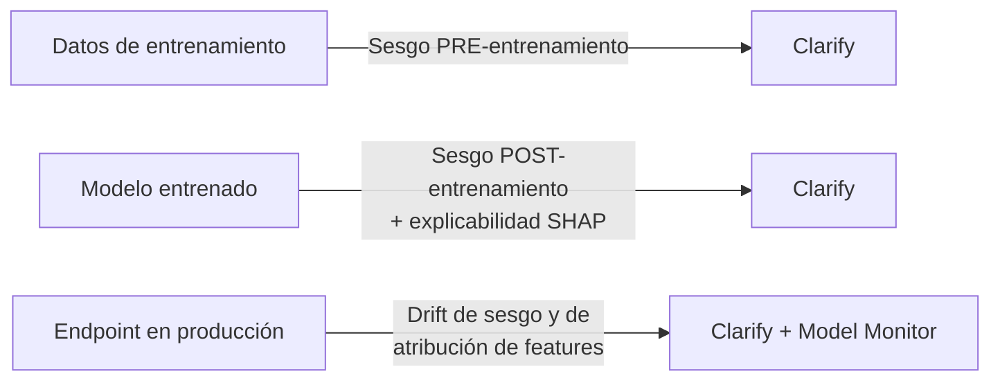

# Dominio 4 — Directrices de IA Responsable (14 %)

> **Peso en el examen:** 14 % (≈ 7 de las 50 preguntas que cuentan).
> **Objetivo:** identificar los pilares de la IA responsable, saber qué herramienta de AWS aborda cada riesgo (sesgo, explicabilidad, drift, contenido dañino, supervisión humana) y comprender las garantías de privacidad de los servicios gestionados.
>
> 🆕 **Guía v1.1:** el objetivo 4.2.2 cita explícitamente **SageMaker Clarify** y **Amazon Bedrock Model Evaluations** como herramientas de explicabilidad/transparencia. Ver [novedades v1.1](../00-exam-guide-v1.1-changes.md#12-objetivos-ampliados).

## Mapeo a los task statements oficiales

| Task statement oficial | Sección |
|---|---|
| 4.1 Explicar el desarrollo de sistemas de IA responsables | [Pilares](#1-pilares-de-la-ia-responsable), [Sesgo y datos](#2-sesgo-equidad-y-calidad-de-datos), [Herramientas](#3-herramientas-nativas-de-aws) |
| 4.2 Reconocer la importancia de modelos transparentes y explicables | [Transparencia y explicabilidad](#4-transparencia-explicabilidad-e-interpretabilidad) |
| (transversal con D5) Privacidad y cumplimiento | [Cumplimiento y privacidad](#5-cumplimiento-normativo-y-privacidad) |

---

## 1. Pilares de la IA responsable

AWS describe la IA responsable a través de varias dimensiones. Para el examen, agrúpalas así:

| Pilar | Definición | Pregunta de control | Herramientas AWS |
|---|---|---|---|
| **Equidad (Fairness)** | El sistema no produce resultados sistemáticamente desfavorables para grupos (género, edad, etnia…). | ¿El modelo aprueba créditos de forma desigual entre grupos? | SageMaker Clarify (métricas de sesgo), Bedrock Model Evaluation |
| **Explicabilidad (Explainability)** | Capacidad de explicar **por qué** el modelo produjo una salida concreta. | ¿Qué variables influyeron en esta predicción? | SageMaker Clarify (SHAP, partial dependence plots), citas en Knowledge Bases |
| **Transparencia** | Comunicar abiertamente cómo se construyó el sistema, sus datos, usos previstos y limitaciones. | ¿Los usuarios saben que interactúan con una IA y cuáles son sus límites? | SageMaker Model Cards, AWS AI Service Cards |
| **Privacidad y seguridad** | Protección de datos personales y del sistema frente a accesos y usos indebidos. | ¿Se filtra PII en prompts, logs o respuestas? | Guardrails (PII), Amazon Macie, AWS KMS, IAM |
| **Robustez / veracidad** | Resultados correctos y fiables incluso ante entradas inesperadas o adversarias. | ¿El modelo alucina? ¿Resiste prompt injection? | Guardrails (grounding, prompt attack), evaluación de robustez |
| **Seguridad (Safety)** | Prevenir salidas dañinas o tóxicas. | ¿Puede generar contenido violento u ofensivo? | Bedrock Guardrails (content filters, denied topics) |
| **Controlabilidad** | Mecanismos para supervisar y dirigir el comportamiento del sistema. | ¿Un humano puede intervenir? | Amazon A2I, trazas de agentes, `return of control` |
| **Gobernanza** | Procesos, roles y controles para gestionar el riesgo durante todo el ciclo de vida. | ¿Quién aprueba el paso a producción? ¿Hay auditoría? | SageMaker Model Registry, Model Cards, Role Manager, CloudTrail, AWS Audit Manager |

> **Otros conceptos evaluados:** *inclusividad* (los datos representan a todas las poblaciones afectadas), **sostenibilidad / impacto ambiental** (elegir el modelo más pequeño que cumpla, reutilizar FMs en lugar de entrenar desde cero), **diseño centrado en el ser humano** (*human-centered design*).

---

## 2. Sesgo, equidad y calidad de datos

### 2.1 Fuentes de sesgo

| Tipo de sesgo | Descripción | Ejemplo |
|---|---|---|
| **Sesgo de muestreo** | El dataset no representa a la población real. | Modelo de reconocimiento facial entrenado mayoritariamente con un grupo demográfico. |
| **Sesgo de medición** | Errores sistemáticos en cómo se recogen/etiquetan los datos. | Etiquetadores con criterios inconsistentes. |
| **Sesgo histórico** | Los datos reflejan desigualdades del pasado. | Modelo de contratación que aprende preferencias históricas discriminatorias. |
| **Sesgo de confirmación / del observador** | Las expectativas de quien diseña influyen en el resultado. | Elegir features que confirman una hipótesis previa. |
| **Sesgo de automatización** | Confiar en exceso en la salida del sistema. | Aprobar sin revisar las decisiones del modelo. |

### 2.2 Características de un dataset responsable

- **Inclusivo y diverso:** representa todos los grupos relevantes.
- **Balanceado:** clases y grupos con proporciones adecuadas (o técnicas de re-muestreo).
- **Curado y de calidad:** sin duplicados, errores ni etiquetas incorrectas.
- **Con procedencia conocida:** origen, licencia y consentimiento documentados (*data lineage*).
- **Con privacidad desde el diseño:** minimización, anonimización/seudonimización de PII.

### 2.3 Efectos del sesgo y de la varianza en grupos demográficos

Un modelo con **overfitting** puede funcionar bien para el grupo mayoritario del entrenamiento y mal para minorías; uno con **underfitting** puede generalizar en exceso y aplicar patrones incorrectos a todos. Ambos casos generan resultados injustos.

---

## 3. Herramientas nativas de AWS

### 3.1 Amazon SageMaker Clarify

Detecta **sesgo** y proporciona **explicabilidad**, en tres momentos del ciclo de vida:



| Capacidad | Detalle | Métricas / técnicas de ejemplo |
|---|---|---|
| **Sesgo pre-entrenamiento** | Analiza el dataset antes de entrenar. | *Class Imbalance (CI)*, *Difference in Proportions of Labels (DPL)*, KL divergence. |
| **Sesgo post-entrenamiento** | Analiza las predicciones del modelo por grupo (*facet*). | *Difference in Positive Proportions in Predicted Labels (DPPL)*, *Disparate Impact (DI)*, diferencias de exactitud/recall entre grupos. |
| **Explicabilidad** | Contribución de cada feature a la predicción (global y local). | **SHAP** (Shapley values), *Partial Dependence Plots*. |
| **Evaluación de FMs** | Evaluación de modelos generativos en exactitud, toxicidad, robustez, estereotipos. | Datasets integrados o propios. |
| **Informes** | Reportes integrados en SageMaker Studio, útiles para auditoría. | — |

### 3.2 Amazon SageMaker Model Cards

**Documentación estandarizada e inmutable por versión** del modelo: uso previsto, riesgo, detalles de entrenamiento, métricas de evaluación, consideraciones éticas y limitaciones. Base de la **transparencia** y la **auditoría**.

```json
{
  "model_overview": {
    "model_name": "credit-risk-xgb-v3",
    "model_description": "Clasificador de riesgo de impago para solicitudes de crédito personal."
  },
  "intended_uses": {
    "purpose_of_model": "Priorizar solicitudes para revisión manual.",
    "intended_uses": "Soporte a analistas; NO para decisiones automáticas de rechazo.",
    "risk_rating": "High"
  },
  "evaluation_details": [
    { "name": "holdout-2026Q3", "metric_groups": [ { "name": "binary_classification", "metric_data": [ { "name": "recall", "type": "number", "value": 0.87 } ] } ] }
  ],
  "additional_information": {
    "ethical_considerations": "Revisado con SageMaker Clarify: DPPL < 0.05 entre grupos de edad.",
    "caveats_and_recommendations": "Re-evaluar si la distribución de ingresos cambia > 10 %."
  }
}
```

> Ejemplo simplificado del contenido de una Model Card. **AWS AI Service Cards** cumplen una función equivalente para los servicios de IA de AWS (uso previsto, limitaciones, buenas prácticas de diseño).

### 3.3 Amazon SageMaker Model Monitor

Monitorea endpoints en producción comparando el tráfico real con una **línea base** y emite métricas/alertas a **CloudWatch**.

| Tipo de monitoreo | Detecta |
|---|---|
| **Data quality** | Cambios en la distribución/esquema de los datos de entrada (*data drift*). |
| **Model quality** | Degradación de métricas (exactitud, RMSE…) comparando con *ground truth*. |
| **Bias drift** | Aparición de sesgo en producción (integración con Clarify). |
| **Feature attribution drift** | Cambios en la importancia de las features (integración con Clarify). |

### 3.4 Otras herramientas de IA responsable

| Herramienta | Uso |
|---|---|
| **Amazon Bedrock Guardrails** | Filtrar contenido dañino, temas prohibidos, PII, alucinaciones (grounding) y ataques de prompt. |
| **Amazon Bedrock Model Evaluation** | Evaluar FMs en exactitud, robustez y toxicidad; evaluación humana y LLM-as-a-judge. |
| **Amazon Augmented AI (A2I)** | Flujos de **revisión humana** (*human-in-the-loop*) cuando la confianza es baja o por muestreo aleatorio para auditoría. |
| **SageMaker Ground Truth** | Etiquetado de alta calidad, incluidos datos de preferencia humana para RLHF. |
| **SageMaker Role Manager** | Definir permisos de mínimo privilegio por persona (data scientist, MLOps). |
| **SageMaker Model Registry / ML Lineage Tracking** | Trazabilidad de versiones, aprobaciones y linaje de datos → modelo → endpoint. |
| **Marca de agua invisible** (Titan Image Generator / Nova Canvas) | Identificar imágenes generadas por IA (transparencia). |

---

## 4. Transparencia, explicabilidad e interpretabilidad

| Concepto | Significado |
|---|---|
| **Interpretabilidad** | Grado en que un humano puede entender el **funcionamiento interno** del modelo (p. ej., árbol de decisión, regresión lineal). |
| **Explicabilidad** | Capacidad de explicar una **salida concreta** aunque el modelo sea una "caja negra" (p. ej., SHAP sobre una red neuronal). |
| **Transparencia** | Documentación y comunicación de datos, diseño, usos y limitaciones (Model Cards). |

### 4.1 Compromiso interpretabilidad vs. desempeño

```text
 Interpretabilidad alta ◄──────────────────────────────────► Desempeño / complejidad alta
 Regresión lineal · Árbol de decisión · Random Forest · XGBoost · Redes neuronales · FMs/LLMs
```

- En dominios **regulados** (crédito, seguros, salud) puede preferirse un modelo más interpretable aunque sea algo menos preciso.
- Si se usa un modelo complejo, se compensa con **herramientas de explicabilidad** (Clarify/SHAP), **documentación** (Model Cards) y **supervisión humana** (A2I).
- En GenAI, la transparencia se refuerza con **citas de fuentes** (RAG), trazas de razonamiento de agentes e información clara al usuario de que habla con una IA.

### 4.2 Riesgos legales y de negocio de la GenAI

- **Propiedad intelectual:** salidas que reproducen material protegido.
- **Salidas sesgadas** con impacto discriminatorio.
- **Pérdida de confianza** del cliente por respuestas incorrectas o inapropiadas.
- **Alucinaciones** con consecuencias (asesoría legal, médica o financiera incorrecta).
- **Responsabilidad del usuario final** y de la organización por el contenido generado.

---

## 5. Cumplimiento normativo y privacidad

### 5.1 Garantías de privacidad en servicios gestionados

| Garantía | Amazon Bedrock | Amazon Q Business | Servicios de IA (Comprehend, Rekognition, Transcribe…) |
|---|---|---|---|
| **Uso de datos para entrenar modelos** | ❌ Los prompts y respuestas **no se usan** para entrenar modelos base ni se comparten con los proveedores. | ❌ No se usan para entrenar los modelos subyacentes. | Algunos servicios pueden usar contenido para mejorar el servicio **salvo que la organización lo desactive** mediante una **AI services opt-out policy** de AWS Organizations. |
| **Personalización** | Los modelos ajustados son **copias privadas** en tu cuenta. | — | Modelos personalizados (Custom Labels, clasificadores de Comprehend) privados de tu cuenta. |
| **Cifrado en reposo** | AWS KMS (claves gestionadas por AWS o **customer managed keys**). | KMS | KMS |
| **Cifrado en tránsito** | TLS 1.2+ | TLS | TLS |
| **Aislamiento de red** | VPC endpoints (AWS PrivateLink). | — | VPC endpoints en la mayoría de servicios. |

```json
{
  "services": {
    "default": {
      "opt_out_policy": { "@@assign": "optOut" }
    }
  }
}
```

> **AI services opt-out policy** (AWS Organizations): impide que AWS almacene/use el contenido procesado por los servicios de IA para su mejora, en todas las cuentas de la organización.

### 5.2 Soberanía y residencia de datos

- Los datos procesados por Bedrock **permanecen en la región** seleccionada.
- **Excepción a considerar:** con *cross-region inference* (inference profiles), las peticiones pueden **procesarse en otras regiones** de la misma geografía (p. ej., regiones de EE. UU. o de la UE). Si la regulación exige una región concreta, usa invocación directa del modelo en esa región o perfiles geográficos acordes.
- Usa **SCPs** con la condición `aws:RequestedRegion` para restringir las regiones permitidas en toda la organización.

### 5.3 Cifrado con AWS KMS

| Recurso | Cifrado |
|---|---|
| Datos de entrenamiento y salida en S3 | SSE-KMS con *customer managed key* |
| Modelos personalizados de Bedrock | KMS (CMK opcional) |
| Knowledge Bases (vector store, sesiones de RetrieveAndGenerate, jobs de ingesta) | KMS |
| Agentes (sesiones/memoria) | KMS |
| Volúmenes de entrenamiento y endpoints de SageMaker | KMS |
| Logs de invocación (S3 / CloudWatch Logs) | KMS |

> **Customer managed keys** dan control sobre rotación, política de clave y revocación, y registran cada uso en CloudTrail → requisito habitual en sectores regulados.

### 5.4 Marcos y normativas a reconocer

- **Normas ISO** (p. ej., ISO/IEC 42001 — sistema de gestión de IA; AWS está certificado), **SOC**, **GDPR**, **HIPAA**, **PCI DSS**.
- **EU AI Act** (enfoque basado en niveles de riesgo), **NIST AI Risk Management Framework**.
- **AWS Artifact** para descargar los informes de cumplimiento de AWS (no los tuyos).

---

## Autoevaluación rápida

- [ ] Nombro los pilares de la IA responsable y una herramienta AWS para cada uno.
- [ ] Distingo sesgo pre-entrenamiento y post-entrenamiento en SageMaker Clarify.
- [ ] Sé para qué sirven Model Cards, Model Monitor y A2I.
- [ ] Explico el compromiso entre interpretabilidad y desempeño.
- [ ] Conozco las garantías de Bedrock sobre no uso de datos para entrenamiento y el efecto de *cross-region inference* en la residencia de datos.

⬅️ Anterior: [Dominio 3](../03-applications-foundation-models/README.md) · ➡️ Siguiente: [Dominio 5 — Seguridad, Cumplimiento y Gobernanza](../05-security-compliance-governance/README.md)
