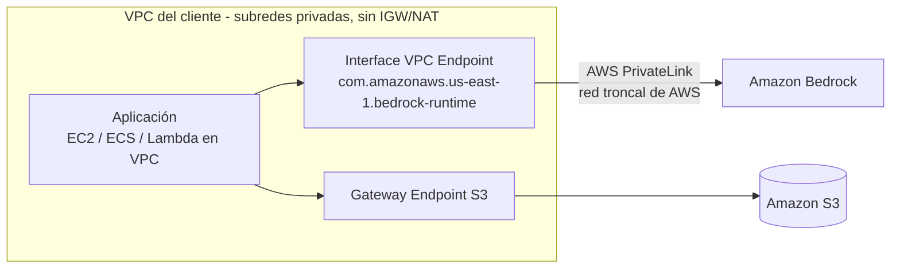
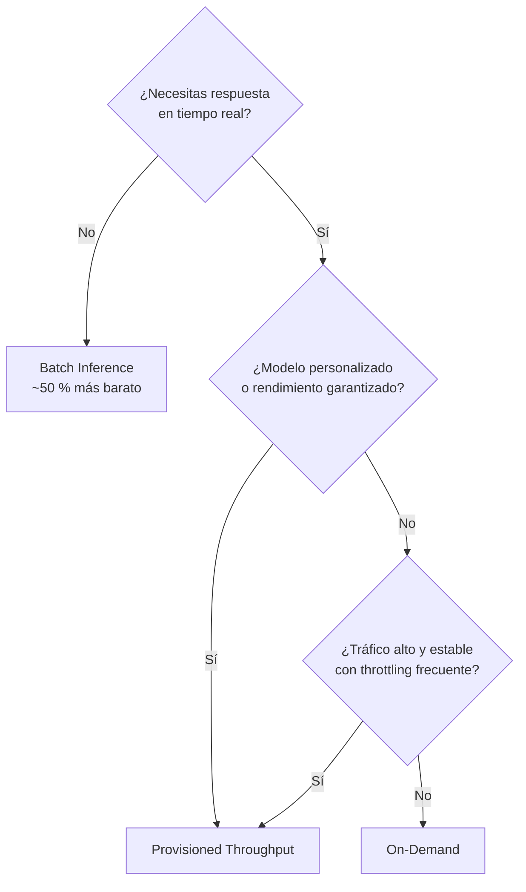

# Dominio 5 — Seguridad, Cumplimiento y Gobernanza en Soluciones de IA (14 %)

> **Peso en el examen:** 14 % (≈ 7 de las 50 preguntas que cuentan).
> **Objetivo:** aplicar el modelo de responsabilidad compartida a cargas GenAI, controlar el acceso a Bedrock y SageMaker con IAM y redes privadas, auditar y monitorear el uso de modelos y elegir el modelo de precios adecuado.
>
> 🆕 **Guía v1.1:** seguridad de agentes con **AgentCore Identity y Policy** (5.1.1) y objetivo nuevo **5.1.5 detección de alucinaciones y grounding**. Ver [novedades v1.1](../00-exam-guide-v1.1-changes.md#56-seguridad-de-agentes-agentcore-identity-y-policy-511).

## Mapeo a los task statements oficiales

| Task statement oficial | Sección |
|---|---|
| 5.1 Explicar métodos para asegurar sistemas de IA | [Responsabilidad compartida](#1-modelo-de-responsabilidad-compartida-aplicado-a-genai), [Control de acceso](#2-control-de-acceso-con-iam), [Red](#3-aislamiento-de-red-vpc-endpoints-aws-privatelink) |
| 5.2 Reconocer regulaciones de gobernanza y cumplimiento para sistemas de IA | [Auditoría y monitoreo](#4-auditoría-y-monitoreo), [Gobernanza de datos](#6-gobernanza-de-datos-y-servicios-de-cumplimiento) |
| (transversal) Costos | [Optimización de costos](#5-optimización-de-costos-en-bedrock) |

---

## 1. Modelo de responsabilidad compartida aplicado a GenAI

```text
┌────────────────────────────────────────────────────────────────────────┐
│ CLIENTE — seguridad EN la nube                                         │
│  • Datos: clasificación, calidad, PII en prompts, datos de RAG y FT    │
│  • IAM: quién invoca qué modelo / KB / agente (mínimo privilegio)      │
│  • Configuración: Guardrails, cifrado con CMK, VPC endpoints, logging  │
│  • Aplicación: validación de entradas, mitigación de prompt injection, │
│    permisos de las herramientas (Lambda) de los agentes                │
│  • Uso responsable y cumplimiento del caso de uso                      │
├────────────────────────────────────────────────────────────────────────┤
│ AWS — seguridad DE la nube                                             │
│  • Infraestructura física, red, hipervisor, hardware acelerado         │
│  • Operación, disponibilidad y parcheo del servicio Bedrock            │
│  • Aislamiento de los modelos y de las cuentas de despliegue           │
│  • No uso de los datos del cliente para entrenar modelos base          │
│  • Cifrado disponible en tránsito y en reposo                          │
└────────────────────────────────────────────────────────────────────────┘
```

### 1.1 La responsabilidad varía según el nivel de abstracción

| Responsabilidad | IA aplicada (Comprehend, Rekognition) | Amazon Bedrock | SageMaker AI (JumpStart / endpoints) | Modelo auto-gestionado en EC2/EKS |
|---|---|---|---|---|
| Infraestructura física | AWS | AWS | AWS | AWS |
| SO, contenedores, parches del runtime | AWS | AWS | AWS (contenedores gestionados) / **Cliente** (contenedores propios) | **Cliente** |
| Escalado y capacidad | AWS | AWS (o PT contratado) | **Cliente** (configura autoescalado) | **Cliente** |
| Seguridad del modelo (pesos, versión) | AWS | AWS / proveedor | **Cliente** | **Cliente** |
| Configuración de red (VPC) | Cliente | Cliente | Cliente | Cliente |
| IAM, datos, cifrado, logging | Cliente | Cliente | Cliente | Cliente |

> Cuanto más **gestionado** el servicio, **menos responsabilidad operativa** para el cliente. Los **datos, la identidad y la configuración** son **siempre** responsabilidad del cliente.

### 1.2 Generative AI Security Scoping Matrix

Marco de AWS para clasificar cargas GenAI según la propiedad del modelo y de los datos:

| Scope | Tipo | Ejemplo | Control del cliente |
|---|---|---|---|
| 1 | Aplicación de consumo | Usar un chatbot público | Mínimo (políticas de uso) |
| 2 | Aplicación empresarial | Amazon Q Business, SaaS con GenAI | Bajo |
| 3 | Modelo pre-entrenado | App propia sobre FMs de Bedrock | Medio |
| 4 | Modelo ajustado (fine-tuned) | Modelo personalizado en Bedrock/SageMaker | Alto |
| 5 | Modelo entrenado por ti | Pre-entrenamiento desde cero en SageMaker | Total |

---

## 2. Control de acceso con IAM

### 2.1 Política de mínimo privilegio para invocar un modelo concreto

```json
{
  "Version": "2012-10-17",
  "Statement": [
    {
      "Sid": "InvokeApprovedModelOnly",
      "Effect": "Allow",
      "Action": [
        "bedrock:InvokeModel",
        "bedrock:InvokeModelWithResponseStream"
      ],
      "Resource": "arn:aws:bedrock:us-east-1::foundation-model/amazon.nova-lite-v1:0"
    }
  ]
}
```

> Las acciones de la **Converse API** (`Converse`, `ConverseStream`) se autorizan con los permisos `bedrock:InvokeModel` / `bedrock:InvokeModelWithResponseStream`. Los ARN de **foundation models** no llevan ID de cuenta (`arn:aws:bedrock:<región>::foundation-model/<id>`).

### 2.2 Forzar Guardrails con IAM

Obliga a que toda invocación incluya un guardrail aprobado; de lo contrario, se deniega:

```json
{
  "Version": "2012-10-17",
  "Statement": [
    {
      "Sid": "AllowInvokeWithApprovedGuardrail",
      "Effect": "Allow",
      "Action": ["bedrock:InvokeModel", "bedrock:InvokeModelWithResponseStream"],
      "Resource": "arn:aws:bedrock:us-east-1::foundation-model/*",
      "Condition": {
        "StringEquals": {
          "bedrock:GuardrailIdentifier": "arn:aws:bedrock:us-east-1:111122223333:guardrail/gr-abc123example:1"
        }
      }
    },
    {
      "Sid": "AllowApplyApprovedGuardrail",
      "Effect": "Allow",
      "Action": "bedrock:ApplyGuardrail",
      "Resource": "arn:aws:bedrock:us-east-1:111122223333:guardrail/gr-abc123example"
    }
  ]
}
```

### 2.3 SCP organizacional: restringir modelos y regiones

```json
{
  "Version": "2012-10-17",
  "Statement": [
    {
      "Sid": "DenyUnapprovedModels",
      "Effect": "Deny",
      "Action": [
        "bedrock:InvokeModel",
        "bedrock:InvokeModelWithResponseStream"
      ],
      "NotResource": [
        "arn:aws:bedrock:*::foundation-model/amazon.nova-*",
        "arn:aws:bedrock:*::foundation-model/amazon.titan-embed-text-v2:0",
        "arn:aws:bedrock:*:*:inference-profile/*",
        "arn:aws:bedrock:*:*:custom-model/*",
        "arn:aws:bedrock:*:*:provisioned-model/*"
      ]
    },
    {
      "Sid": "DenyBedrockOutsideApprovedRegions",
      "Effect": "Deny",
      "Action": "bedrock:*",
      "Resource": "*",
      "Condition": {
        "StringNotEquals": { "aws:RequestedRegion": ["us-east-1", "eu-west-1"] }
      }
    }
  ]
}
```

> Las **SCPs** no conceden permisos: establecen el **máximo** permitido en las cuentas de la organización. Son la herramienta de gobernanza para "*ningún equipo puede usar modelos no aprobados*". (Si permites *inference profiles*, ten en cuenta que pueden enrutar a otras regiones de la geografía; ajusta la condición de región en consecuencia.)

### 2.4 IAM para SageMaker AI

| Control | Cómo |
|---|---|
| **Rol de ejecución** | Cada job/endpoint/notebook asume un rol IAM con acceso solo a sus buckets S3 y claves KMS. |
| **Forzar VPC** | Condiciones `sagemaker:VpcSubnets` y `sagemaker:VpcSecurityGroupIds` en `CreateTrainingJob`, `CreateModel`, etc. |
| **Network isolation** | `EnableNetworkIsolation=true`: el contenedor no tiene acceso saliente a Internet. |
| **Cifrado obligatorio** | Condición `sagemaker:VolumeKmsKey` / `sagemaker:OutputKmsKey`. |
| **Personas** | **SageMaker Role Manager** genera políticas de mínimo privilegio por rol (data scientist, MLOps). |
| **Acceso a Studio** | IAM Identity Center o IAM; dominios con perfiles de usuario aislados. |

### 2.5 Roles de servicio (Bedrock)

Bedrock **asume roles de servicio** para actuar en tu nombre (Knowledge Bases leyendo S3, jobs de fine-tuning, agentes). Trust policy típica, con protección contra el problema del *confused deputy*:

```json
{
  "Version": "2012-10-17",
  "Statement": [
    {
      "Effect": "Allow",
      "Principal": { "Service": "bedrock.amazonaws.com" },
      "Action": "sts:AssumeRole",
      "Condition": {
        "StringEquals": { "aws:SourceAccount": "111122223333" },
        "ArnLike": { "aws:SourceArn": "arn:aws:bedrock:us-east-1:111122223333:knowledge-base/*" }
      }
    }
  ]
}
```

---

## 3. Aislamiento de red: VPC Endpoints (AWS PrivateLink)

Para que el tráfico de inferencia **no atraviese Internet**, crea **interface VPC endpoints** de Bedrock en subredes privadas.



| Endpoint (servicio) | Para |
|---|---|
| `com.amazonaws.<región>.bedrock` | Plano de control |
| `com.amazonaws.<región>.bedrock-runtime` | Inferencia (`InvokeModel`, `Converse`) |
| `com.amazonaws.<región>.bedrock-agent` | Construcción de agentes y KBs |
| `com.amazonaws.<región>.bedrock-agent-runtime` | `InvokeAgent`, `Retrieve`, `RetrieveAndGenerate` |
| `com.amazonaws.<región>.sagemaker.runtime` | Inferencia en endpoints de SageMaker |
| `com.amazonaws.<región>.sagemaker.api` | API de SageMaker |

```bash
aws ec2 create-vpc-endpoint \
  --vpc-id vpc-0abc1234 \
  --vpc-endpoint-type Interface \
  --service-name com.amazonaws.us-east-1.bedrock-runtime \
  --subnet-ids subnet-0aaa1111 subnet-0bbb2222 \
  --security-group-ids sg-0ccc3333 \
  --private-dns-enabled \
  --policy-document file://vpce-bedrock-policy.json
```

**Endpoint policy** para limitar qué principales y modelos pueden usarse a través del endpoint:

```json
{
  "Statement": [
    {
      "Effect": "Allow",
      "Principal": { "AWS": "arn:aws:iam::111122223333:role/app-genai-role" },
      "Action": ["bedrock:InvokeModel", "bedrock:InvokeModelWithResponseStream"],
      "Resource": "arn:aws:bedrock:us-east-1::foundation-model/amazon.nova-lite-v1:0"
    }
  ]
}
```

> Complementa con la condición `aws:SourceVpce` en políticas IAM para **denegar** invocaciones que no procedan del endpoint.

---

## 4. Auditoría y monitoreo

### 4.1 Qué servicio responde a qué pregunta

| Pregunta | Servicio |
|---|---|
| **¿Quién** llamó a qué API de Bedrock/SageMaker, cuándo y desde dónde? | **AWS CloudTrail** |
| **¿Qué** prompt se envió y **qué** respondió el modelo? | **Bedrock Model Invocation Logging** (a S3 y/o CloudWatch Logs) |
| ¿Cuántas invocaciones, tokens, latencia, errores, *throttling*? | **Amazon CloudWatch Metrics** (namespace `AWS/Bedrock`) |
| ¿Alertar cuando algo supera un umbral? | **CloudWatch Alarms** → Amazon SNS |
| ¿Los recursos cumplen las reglas de configuración? | **AWS Config** |
| ¿Hay PII en los buckets de datos de entrenamiento/RAG? | **Amazon Macie** |
| ¿Hay vulnerabilidades en las imágenes/Lambda del sistema? | **Amazon Inspector** |
| ¿Hay actividad sospechosa en la cuenta? | **Amazon GuardDuty** |
| Vista consolidada de hallazgos de seguridad | **AWS Security Hub** |
| ¿Evidencia para auditorías? | **AWS Audit Manager** |
| ¿Informes de cumplimiento de AWS (SOC, ISO)? | **AWS Artifact** |

> **Distinción clave de examen:** CloudTrail registra **metadatos de las llamadas a la API** (identidad, acción, hora, IP), **no el contenido** de prompts y respuestas. Para auditar contenido → **Model Invocation Logging**.

### 4.2 Habilitar Model Invocation Logging

```bash
aws bedrock put-model-invocation-logging-configuration \
  --logging-config '{
    "cloudWatchConfig": {
      "logGroupName": "/aws/bedrock/invocations",
      "roleArn": "arn:aws:iam::111122223333:role/BedrockLoggingRole"
    },
    "s3Config": {
      "bucketName": "my-bedrock-invocation-logs",
      "keyPrefix": "invocations/"
    },
    "textDataDeliveryEnabled": true,
    "imageDataDeliveryEnabled": false,
    "embeddingDataDeliveryEnabled": false
  }'
```

> Los logs de invocación contienen **datos potencialmente sensibles**: cífralos con KMS, restringe el acceso y define retención.

### 4.3 Métricas de CloudWatch (`AWS/Bedrock`)

| Métrica | Uso |
|---|---|
| `Invocations` | Volumen de peticiones. |
| `InvocationLatency` | Latencia (SLO de la aplicación). |
| `InvocationClientErrors` / `InvocationServerErrors` | Errores 4xx / 5xx. |
| `InvocationThrottles` | Peticiones limitadas → señal para Provisioned Throughput o *cross-region inference*. |
| `InputTokenCount` / `OutputTokenCount` | **Consumo de tokens → costo**. |

```bash
# Alarma cuando el consumo de tokens de salida supera 1M en 1 hora para un modelo
aws cloudwatch put-metric-alarm \
  --alarm-name bedrock-output-tokens-high \
  --namespace AWS/Bedrock \
  --metric-name OutputTokenCount \
  --dimensions Name=ModelId,Value=amazon.nova-lite-v1:0 \
  --statistic Sum --period 3600 --evaluation-periods 1 \
  --threshold 1000000 --comparison-operator GreaterThanThreshold \
  --alarm-actions arn:aws:sns:us-east-1:111122223333:genai-alerts
```

### 4.4 Ejemplo de evento de CloudTrail (resumido)

```json
{
  "eventSource": "bedrock.amazonaws.com",
  "eventName": "InvokeModel",
  "awsRegion": "us-east-1",
  "sourceIPAddress": "10.0.12.34",
  "userIdentity": { "type": "AssumedRole", "arn": "arn:aws:sts::111122223333:assumed-role/app-genai-role/session" },
  "requestParameters": { "modelId": "amazon.nova-lite-v1:0" },
  "vpcEndpointId": "vpce-0123456789abcdef0"
}
```

---

## 5. Optimización de costos en Bedrock

### 5.1 Modelos de precios

| Opción | Cómo se paga | Ventajas | Desventajas | Úsalo cuando… |
|---|---|---|---|---|
| **On-Demand** | Por **token** de entrada y salida (imágenes: por imagen). Sin compromiso. | Flexible, sin costo fijo, ideal para empezar. | Sujeto a cuotas (*throttling*) en picos; precio unitario más alto. | Cargas variables, prototipos, tráfico impredecible o bajo/medio. |
| **Batch Inference** | Por token, con **descuento (~50 %)** frente a On-Demand en los modelos soportados. | Mucho más barato para grandes volúmenes. | **Asíncrono** (entrada/salida en S3, JSONL), sin latencia garantizada. | Procesamiento masivo sin requisito de tiempo real: resumir miles de documentos, clasificar históricos, generar embeddings. |
| **Provisioned Throughput** | Por **hora** y por *Model Unit* (MU) reservada; sin compromiso, o con compromiso de **1 o 6 meses** (más barato). | **Rendimiento garantizado**, sin throttling; necesario tradicionalmente para servir **modelos personalizados**. | Costo fijo aunque no se use; requiere dimensionar. | Producción con tráfico alto y **predecible**, SLA estrictos, modelos fine-tuned. |



### 5.2 Otras palancas de costo

| Palanca | Efecto |
|---|---|
| **Elegir el modelo adecuado** | Un modelo pequeño (p. ej., Nova Micro/Lite) puede costar un orden de magnitud menos que uno grande. Evalúa antes de elegir. |
| **Prompt caching** | Reutiliza prefijos de prompt repetidos (system prompt, documentos largos) → menor costo y latencia en los tokens cacheados. |
| **Intelligent Prompt Routing** | Enruta cada petición al modelo de una familia que ofrece la calidad necesaria al menor costo. |
| **Model distillation** | Modelo más pequeño con calidad cercana al grande. |
| **Controlar `maxTokens`** y la longitud del prompt | Los tokens de salida suelen ser más caros que los de entrada. |
| **RAG en vez de contexto completo** | Enviar solo los chunks relevantes en lugar de documentos enteros. |
| **Cross-region inference** | Más capacidad en picos sin pagar Provisioned Throughput (sin recargo por enrutamiento). |
| **Vector store adecuado** | OpenSearch Serverless tiene un costo mínimo por OCU-hora; para volúmenes grandes con poco tráfico, considera S3 Vectors o Aurora. |
| **Etiquetas de asignación de costos + AWS Budgets** | Visibilidad por equipo/proyecto (application inference profiles permiten etiquetar el uso). |

### 5.3 Costos de SageMaker AI (comparativa rápida)

- Endpoints en tiempo real: pago por **hora de instancia** aunque no haya tráfico.
- **Serverless Inference** y **Asynchronous Inference** (con escala a cero): reducen costo en tráfico intermitente.
- **Managed Spot Training**: hasta ~90 % de ahorro en entrenamiento tolerante a interrupciones (con checkpoints).
- **SageMaker Savings Plans** para uso sostenido.

---

## 6. Gobernanza de datos y servicios de cumplimiento

| Práctica | Servicio / mecanismo |
|---|---|
| Catálogo y descubrimiento de datos | AWS Glue Data Catalog, Amazon SageMaker Catalog / Amazon DataZone |
| Permisos finos sobre el data lake (tabla/columna/fila) | AWS Lake Formation |
| Linaje de datos y modelos | SageMaker ML Lineage Tracking, Model Registry |
| Retención y ciclo de vida | S3 Lifecycle, S3 Object Lock (WORM), retención de CloudWatch Logs |
| Registro y auditoría continua | CloudTrail (multi-región, organization trail), AWS Config, Audit Manager |
| Clasificación y detección de datos sensibles | Amazon Macie |
| Controles preventivos multi-cuenta | AWS Organizations (SCPs, AI services opt-out policies), AWS Control Tower |
| Revisión de arquitectura | AWS Well-Architected Framework — **Generative AI Lens** y **Machine Learning Lens** |

**Estrategia de gobernanza GenAI (resumen):** políticas de uso aceptable → inventario de modelos y casos de uso → evaluación de riesgos (Scoping Matrix) → controles técnicos (IAM, Guardrails, red, cifrado) → monitoreo y auditoría → revisiones periódicas → formación de los equipos.

### 6.1 Amenazas específicas de aplicaciones LLM

El **OWASP Top 10 for LLM Applications** es una referencia útil: prompt injection, divulgación de información sensible, riesgos de la cadena de suministro, envenenamiento de datos y modelos, manejo inseguro de la salida, agencia excesiva (agentes con demasiados permisos), fuga del system prompt, debilidades en vectores/embeddings, desinformación y consumo ilimitado de recursos.

---

## Autoevaluación rápida

- [ ] Dibujo la línea de responsabilidad compartida para Bedrock vs. SageMaker vs. EC2.
- [ ] Escribo una política IAM que solo permita invocar un modelo concreto y otra que fuerce un guardrail.
- [ ] Explico cómo invocar Bedrock sin salir a Internet (PrivateLink).
- [ ] Distingo CloudTrail (quién/cuándo) de Model Invocation Logging (qué prompt/respuesta).
- [ ] Elijo entre On-Demand, Batch y Provisioned Throughput según latencia, volumen y personalización.

⬅️ Anterior: [Dominio 4](../04-responsible-ai/README.md) · 🏠 [Volver al inicio](../../README.md)
