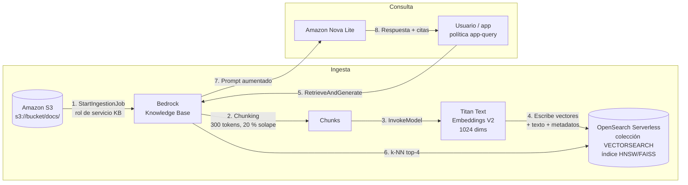

# Lab 01 — Pipeline RAG con Amazon Bedrock Knowledge Bases, Amazon S3 y OpenSearch Serverless

| Campo | Valor |
|---|---|
| **Dominio(s) del examen** | D2 — Técnicas de adaptación (RAG) · D3 — Bedrock Knowledge Bases (task 3.1) · D5 — IAM y costos (task 5.1) |
| **Nivel** | Intermedio |
| **Duración estimada** | 60–90 min |
| **Costo estimado** | < USD 2 si se ejecuta la [limpieza](#limpieza) al terminar (ver [Costos](#costos)) |
| **Región probada** | `us-east-1` |
| **Servicios** | Amazon Bedrock (Knowledge Bases, Titan Text Embeddings V2, Amazon Nova Lite), Amazon S3, Amazon OpenSearch Serverless, AWS IAM |
| **Última verificación** | 2026-10 |

## Objetivos de aprendizaje

Al finalizar este laboratorio serás capaz de:

1. Construir un pipeline **RAG gestionado** con Amazon Bedrock Knowledge Bases sobre documentos almacenados en Amazon S3.
2. Configurar una colección **vector search** de Amazon OpenSearch Serverless con sus tres políticas (cifrado, red y acceso a datos).
3. Diseñar un **rol de servicio IAM de mínimo privilegio** para la Knowledge Base y una política de consumo para la aplicación.
4. Diferenciar las APIs `Retrieve` y `RetrieveAndGenerate` y verificar las **citas** de las respuestas.
5. Estimar y controlar los **costos** de una arquitectura RAG.

## Arquitectura



**Decisiones de diseño:**

- **Chunking de tamaño fijo (300 tokens, 20 % de solapamiento):** documentos cortos y homogéneos; el solapamiento evita cortar una regla de negocio entre dos chunks.
- **Titan Text Embeddings V2 (1024 dimensiones):** modelo de embeddings de Amazon, multilingüe y de bajo costo. La dimensión del índice **debe coincidir** con la del modelo.
- **OpenSearch Serverless sin réplicas en espera (`--standby-replicas DISABLED`):** reduce el costo mínimo; **solo para entornos de desarrollo/prueba**.
- **Amazon Nova Lite como generador:** bajo costo por token y buena calidad para Q&A sobre documentos.

## Prerrequisitos

- [ ] Cuenta de AWS y una identidad con permisos de administración para el laboratorio (IAM, S3, OpenSearch Serverless, Bedrock), incluido `iam:PassRole` sobre el rol de la KB.
- [ ] **AWS CLI v2** reciente (`aws --version`) y credenciales configuradas (`aws sts get-caller-identity`).
- [ ] **Python 3.10+** y dependencias: `pip install -r scripts/requirements.txt`.
- [ ] Acceso a los modelos `amazon.titan-embed-text-v2:0` y `amazon.nova-lite-v1:0` en la región (según la configuración de la cuenta puede requerirse habilitarlos en *Bedrock → Model access*).
- [ ] `bash` (Linux, macOS o WSL). Ejecuta todos los comandos desde el directorio de este laboratorio.

## IAM mínimo viable

| Identidad | Permisos | Archivo |
|---|---|---|
| **Rol de servicio de la KB** (trust) | Solo `bedrock.amazonaws.com` puede asumirlo, y **solo desde Knowledge Bases de tu cuenta y región** (`aws:SourceAccount` + `aws:SourceArn` → protección contra *confused deputy*). | [`policies/kb-trust-policy.json`](policies/kb-trust-policy.json) |
| **Rol de servicio de la KB** (permisos) | `bedrock:InvokeModel` **solo** sobre el modelo de embeddings · `s3:ListBucket` sobre el bucket · `s3:GetObject` **solo** sobre `docs/*` · `aoss:APIAccessAll` **solo** sobre la colección. | [`policies/kb-permissions-policy.json`](policies/kb-permissions-policy.json) |
| **Rol de servicio de la KB** (plano de datos AOSS) | `DescribeCollectionItems` + leer/escribir documentos y describir el índice. **No** puede crear ni borrar índices. | [`policies/aoss-data-access-policy.json`](policies/aoss-data-access-policy.json) |
| **Identidad del laboratorio** (plano de datos AOSS) | Crear y administrar el índice vectorial. | [`policies/aoss-data-access-policy.json`](policies/aoss-data-access-policy.json) |
| **Aplicación consumidora** | `bedrock:Retrieve` / `bedrock:RetrieveAndGenerate` **solo** sobre esta KB · `bedrock:InvokeModel` **solo** sobre el modelo generador (y su inference profile). | [`policies/app-query-policy.json`](policies/app-query-policy.json) |

> **Doble capa de autorización en OpenSearch Serverless:** la política IAM concede `aoss:APIAccessAll` (llegar a la colección) y la **data access policy** de la colección decide qué puede hacer cada principal con índices y documentos. Faltar en cualquiera de las dos produce un `403`.

**Observa:** el rol de la KB **no** tiene permiso para invocar el modelo generador. En `RetrieveAndGenerate` la generación se autoriza con las credenciales **de quien llama** (la aplicación).

## Pasos

### Paso 0 — Variables de entorno y función de renderizado

```bash
cd labs/lab-01-rag-bedrock-knowledge-bases
mkdir -p build

export AWS_REGION=us-east-1
export AWS_ACCOUNT_ID=$(aws sts get-caller-identity --query Account --output text)
export BUCKET="kb-lab01-docs-${AWS_ACCOUNT_ID}-${AWS_REGION}"
export COLLECTION_NAME="kb-lab01"
export INDEX_NAME="bedrock-kb-index"
export KB_ROLE_NAME="AmazonBedrockExecutionRoleForKnowledgeBase_lab01"
export EMBEDDING_MODEL_ARN="arn:aws:bedrock:${AWS_REGION}::foundation-model/amazon.titan-embed-text-v2:0"
# Modelo generador: si la invocación directa no está disponible en tu región,
# usa el inference profile: arn:aws:bedrock:${AWS_REGION}:${AWS_ACCOUNT_ID}:inference-profile/us.amazon.nova-lite-v1:0
export GEN_MODEL_ARN="arn:aws:bedrock:${AWS_REGION}::foundation-model/amazon.nova-lite-v1:0"

# La data access policy de AOSS necesita el ARN de un usuario o ROL IAM, no el de una sesión STS.
CALLER_ARN=$(aws sts get-caller-identity --query Arn --output text)
if [[ "$CALLER_ARN" == *":assumed-role/"* ]]; then
  export ADMIN_PRINCIPAL_ARN=$(aws iam get-role --role-name "$(echo "$CALLER_ARN" | cut -d/ -f2)" \
    --query Role.Arn --output text)
else
  export ADMIN_PRINCIPAL_ARN="$CALLER_ARN"
fi
echo "Principal administrador: $ADMIN_PRINCIPAL_ARN"

# Sustituye los marcadores __X__ de las políticas por los valores reales (compatible con GNU y BSD sed).
render() {
  sed -e "s|__ACCOUNT_ID__|${AWS_ACCOUNT_ID}|g" \
      -e "s|__REGION__|${AWS_REGION}|g" \
      -e "s|__BUCKET__|${BUCKET}|g" \
      -e "s|__COLLECTION_NAME__|${COLLECTION_NAME}|g" \
      -e "s|__COLLECTION_ID__|${COLLECTION_ID:-}|g" \
      -e "s|__KB_ROLE_ARN__|${KB_ROLE_ARN:-}|g" \
      -e "s|__ADMIN_PRINCIPAL_ARN__|${ADMIN_PRINCIPAL_ARN:-}|g" \
      -e "s|__KB_ID__|${KB_ID:-}|g" \
      "policies/$1" > "build/$1"
}
```

### Paso 1 — Bucket S3 con los documentos fuente

Los buckets nuevos tienen **Block Public Access** activado y cifrado **SSE-S3** por defecto. Activamos además el versionado para poder auditar cambios en la fuente de conocimiento.

```bash
aws s3 mb "s3://${BUCKET}" --region "$AWS_REGION"
aws s3api put-bucket-versioning --bucket "$BUCKET" --versioning-configuration Status=Enabled
aws s3 cp sample-data/ "s3://${BUCKET}/docs/" --recursive
aws s3 ls "s3://${BUCKET}/docs/"
```

**Resultado esperado:** tres archivos `.md` bajo `docs/` (políticas ficticias de vacaciones, teletrabajo y FAQ de soporte IT).

### Paso 2 — Colección vectorial de OpenSearch Serverless

Una colección necesita **antes** de crearse una política de **cifrado** y una de **red** que la cubran.

```bash
render aoss-encryption-policy.json
render aoss-network-policy.json

aws opensearchserverless create-security-policy --name "${COLLECTION_NAME}-enc" \
  --type encryption --policy file://build/aoss-encryption-policy.json
aws opensearchserverless create-security-policy --name "${COLLECTION_NAME}-net" \
  --type network --policy file://build/aoss-network-policy.json

aws opensearchserverless create-collection --name "$COLLECTION_NAME" \
  --type VECTORSEARCH --standby-replicas DISABLED

# Esperar a que la colección esté ACTIVE (suele tardar unos minutos)
until [ "$(aws opensearchserverless batch-get-collection --names "$COLLECTION_NAME" \
  --query 'collectionDetails[0].status' --output text)" = "ACTIVE" ]; do
  echo "Colección en creación..."; sleep 20
done

export COLLECTION_ID=$(aws opensearchserverless batch-get-collection --names "$COLLECTION_NAME" \
  --query 'collectionDetails[0].id' --output text)
export COLLECTION_ARN=$(aws opensearchserverless batch-get-collection --names "$COLLECTION_NAME" \
  --query 'collectionDetails[0].arn' --output text)
export COLLECTION_ENDPOINT=$(aws opensearchserverless batch-get-collection --names "$COLLECTION_NAME" \
  --query 'collectionDetails[0].collectionEndpoint' --output text)
echo "$COLLECTION_ARN -> $COLLECTION_ENDPOINT"
```

> **Producción:** usa `AllowFromPublic: false` con un **VPC endpoint de OpenSearch Serverless** y permite el acceso del servicio Bedrock mediante `"SourceServices": ["bedrock.amazonaws.com"]` en la política de red; cifra con una **customer managed key** (`"KmsARN"` en lugar de `"AWSOwnedKey": true`) y habilita las réplicas en espera.

### Paso 3 — Rol de servicio IAM de la Knowledge Base

```bash
render kb-trust-policy.json
render kb-permissions-policy.json

export KB_ROLE_ARN=$(aws iam create-role --role-name "$KB_ROLE_NAME" \
  --assume-role-policy-document file://build/kb-trust-policy.json \
  --description "Rol de servicio de la Knowledge Base del Lab 01" \
  --query Role.Arn --output text)

aws iam put-role-policy --role-name "$KB_ROLE_NAME" \
  --policy-name kb-lab01-permissions \
  --policy-document file://build/kb-permissions-policy.json
```

### Paso 4 — Data access policy de la colección

```bash
render aoss-data-access-policy.json
aws opensearchserverless create-access-policy --name "${COLLECTION_NAME}-data" \
  --type data --policy file://build/aoss-data-access-policy.json
```

### Paso 5 — Índice vectorial

Bedrock **no crea** el índice cuando se usa la API (la opción *Quick create* de la consola sí lo hace). El script crea un índice `knn_vector` HNSW/FAISS de **1024 dimensiones** con los nombres de campo que usará la KB y reintenta mientras se propaga la data access policy.

```bash
pip install -r scripts/requirements.txt
python scripts/create_vector_index.py \
  --endpoint "$COLLECTION_ENDPOINT" --region "$AWS_REGION" --index "$INDEX_NAME"
```

| Campo del índice | Contenido |
|---|---|
| `bedrock-knowledge-base-default-vector` | Embedding del chunk (`knn_vector`, 1024 dims). |
| `AMAZON_BEDROCK_TEXT_CHUNK` | Texto original del chunk (se devuelve en la recuperación). |
| `AMAZON_BEDROCK_METADATA` | Metadatos gestionados por Bedrock (origen S3, página…). |

### Paso 6 — Crear la Knowledge Base

```bash
cat > build/kb-storage.json <<EOF
{
  "type": "OPENSEARCH_SERVERLESS",
  "opensearchServerlessConfiguration": {
    "collectionArn": "${COLLECTION_ARN}",
    "vectorIndexName": "${INDEX_NAME}",
    "fieldMapping": {
      "vectorField": "bedrock-knowledge-base-default-vector",
      "textField": "AMAZON_BEDROCK_TEXT_CHUNK",
      "metadataField": "AMAZON_BEDROCK_METADATA"
    }
  }
}
EOF

cat > build/kb-config.json <<EOF
{
  "type": "VECTOR",
  "vectorKnowledgeBaseConfiguration": {
    "embeddingModelArn": "${EMBEDDING_MODEL_ARN}"
  }
}
EOF

export KB_ID=$(aws bedrock-agent create-knowledge-base \
  --name kb-lab01 \
  --description "Lab 01 - politicas internas ficticias" \
  --role-arn "$KB_ROLE_ARN" \
  --knowledge-base-configuration file://build/kb-config.json \
  --storage-configuration file://build/kb-storage.json \
  --query knowledgeBase.knowledgeBaseId --output text)

aws bedrock-agent get-knowledge-base --knowledge-base-id "$KB_ID" \
  --query 'knowledgeBase.[name,status]' --output text
```

**Resultado esperado:** estado `ACTIVE`. Bedrock valida en este paso que el rol puede acceder al índice y que el mapeo de campos es correcto.

### Paso 7 — Data source e ingesta

```bash
cat > build/ds-config.json <<EOF
{
  "type": "S3",
  "s3Configuration": {
    "bucketArn": "arn:aws:s3:::${BUCKET}",
    "inclusionPrefixes": ["docs/"]
  }
}
EOF

cat > build/ds-chunking.json <<'EOF'
{
  "chunkingConfiguration": {
    "chunkingStrategy": "FIXED_SIZE",
    "fixedSizeChunkingConfiguration": { "maxTokens": 300, "overlapPercentage": 20 }
  }
}
EOF

export DS_ID=$(aws bedrock-agent create-data-source \
  --knowledge-base-id "$KB_ID" --name s3-docs \
  --data-source-configuration file://build/ds-config.json \
  --vector-ingestion-configuration file://build/ds-chunking.json \
  --query dataSource.dataSourceId --output text)

export JOB_ID=$(aws bedrock-agent start-ingestion-job \
  --knowledge-base-id "$KB_ID" --data-source-id "$DS_ID" \
  --query ingestionJob.ingestionJobId --output text)

while true; do
  STATUS=$(aws bedrock-agent get-ingestion-job --knowledge-base-id "$KB_ID" \
    --data-source-id "$DS_ID" --ingestion-job-id "$JOB_ID" \
    --query ingestionJob.status --output text)
  echo "Ingesta: $STATUS"
  [[ "$STATUS" == "COMPLETE" || "$STATUS" == "FAILED" ]] && break
  sleep 15
done

aws bedrock-agent get-ingestion-job --knowledge-base-id "$KB_ID" \
  --data-source-id "$DS_ID" --ingestion-job-id "$JOB_ID" \
  --query ingestionJob.statistics
```

**Resultado esperado:** `COMPLETE` con `numberOfDocumentsScanned: 3`, `numberOfNewDocumentsIndexed: 3` y `numberOfDocumentsFailed: 0`.

> La ingesta es **incremental**: si modificas o borras documentos en S3, vuelve a ejecutar `start-ingestion-job` para sincronizar solo los cambios. Esta es la ventaja clave de RAG frente al fine-tuning: el conocimiento se actualiza **sin re-entrenar**.

### Paso 8 — Consultar: `Retrieve` vs. `RetrieveAndGenerate`

**8.1 Solo recuperación** (devuelve chunks con su *score*; tú construirías el prompt):

```bash
python scripts/query_kb.py --kb-id "$KB_ID" --region "$AWS_REGION" --retrieve-only \
  "¿Cuántos días de vacaciones puedo trasladar al año siguiente?"
```

**8.2 Recuperación + generación con citas:**

```bash
aws bedrock-agent-runtime retrieve-and-generate \
  --input '{"text": "¿Cuántos días de vacaciones tengo si llevo 6 años en la empresa?"}' \
  --retrieve-and-generate-configuration "{
    \"type\": \"KNOWLEDGE_BASE\",
    \"knowledgeBaseConfiguration\": {
      \"knowledgeBaseId\": \"${KB_ID}\",
      \"modelArn\": \"${GEN_MODEL_ARN}\",
      \"retrievalConfiguration\": { \"vectorSearchConfiguration\": { \"numberOfResults\": 4 } }
    }
  }" \
  --query '[output.text, citations[].retrievedReferences[].location.s3Location.uri]'
```

O con el script (muestra respuesta, fuentes y `sessionId`):

```bash
python scripts/query_kb.py --kb-id "$KB_ID" --model-arn "$GEN_MODEL_ARN" --region "$AWS_REGION" \
  "¿Cuál es el tiempo de primera respuesta para una incidencia P2?"
```

**8.3 Prueba de anclaje (*grounding*):** pregunta algo que **no** está en los documentos.

```bash
python scripts/query_kb.py --kb-id "$KB_ID" --model-arn "$GEN_MODEL_ARN" --region "$AWS_REGION" \
  "¿Cuál es la política de coches de empresa?"
```

**Resultado esperado:** el modelo indica que no encuentra la información en lugar de inventarla, y la lista de citas aparece vacía.

## Validación

- [ ] `get-knowledge-base` devuelve `ACTIVE`.
- [ ] La ingesta terminó en `COMPLETE` con 0 documentos fallidos.
- [ ] La respuesta sobre 6 años de antigüedad menciona **24 días** (22 + 2) y cita `politica-vacaciones.md`.
- [ ] La respuesta sobre P2 menciona **1 hora** y cita `faq-soporte-it.md`.
- [ ] La pregunta fuera de dominio no produce una respuesta inventada.
- [ ] (Opcional) Con una identidad que solo tenga [`app-query-policy.json`](policies/app-query-policy.json), `RetrieveAndGenerate` funciona y cualquier otra acción de Bedrock es denegada.

## Troubleshooting

| Síntoma | Causa probable | Solución |
|---|---|---|
| `403 / AuthorizationException` al crear el índice | La identidad no está en la data access policy, se usó un ARN de sesión STS, o la política aún no se propagó. | Revisa `ADMIN_PRINCIPAL_ARN` (debe ser `arn:aws:iam::...:role/...` o `:user/...`); espera 1–2 min y reintenta. |
| `ValidationException` en `create-knowledge-base` mencionando el índice o un `security_exception` | El rol de la KB no figura en la data access policy, le falta `aoss:APIAccessAll` o el índice no existe. | Verifica `build/aoss-data-access-policy.json` y `build/kb-permissions-policy.json`; confirma el nombre del índice. |
| Error de dimensión del vector durante la ingesta | La dimensión del índice no coincide con la del modelo de embeddings. | Titan Text Embeddings V2 usa 1024 por defecto: recrea el índice con esa dimensión. |
| `numberOfDocumentsFailed > 0` | Formato no soportado, archivo demasiado grande o falta `s3:GetObject` sobre el prefijo. | Consulta `failureReasons` en `get-ingestion-job`; revisa formatos/tamaños soportados y la política S3. |
| `AccessDeniedException` sobre el modelo generador | Modelo no habilitado en la cuenta, o requiere *inference profile* en la región. | Habilita el modelo o usa el ARN del inference profile `us.amazon.nova-lite-v1:0` en `GEN_MODEL_ARN`. |
| Respuestas genéricas sin citas | Recuperación pobre (chunks irrelevantes). | Prueba `--retrieve-only`, aumenta `numberOfResults`, ajusta el chunking o añade metadatos/filtros. |

## Costos

| Recurso | Modelo de precios (referencia `us-east-1`) | Estimación para ~2 h de laboratorio |
|---|---|---|
| **OpenSearch Serverless** | Por **OCU-hora** (≈ USD 0,24) para indexación y búsqueda, **facturado aunque no haya tráfico**; el mínimo con réplicas deshabilitadas es inferior al de producción (con réplicas). Almacenamiento por GB-mes. | ≈ USD 0,50–1,00 |
| **Titan Text Embeddings V2** | Por token de entrada (≈ USD 0,02 por millón). | < USD 0,01 |
| **Amazon Nova Lite** | Por token de entrada (≈ USD 0,06 / M) y de salida (≈ USD 0,24 / M). | < USD 0,01 |
| **Amazon S3** | Almacenamiento y peticiones. | < USD 0,01 |
| **Bedrock Knowledge Bases** | Sin cargo adicional por la KB: pagas embeddings, modelo generador y vector store. | USD 0 |

> ⚠️ **El vector store domina el costo.** Una colección de OpenSearch Serverless olvidada puede costar **del orden de USD 175 o más al mes** aunque no reciba consultas. Si necesitas mantener la KB activa a bajo costo, valora **Amazon S3 Vectors** o **Aurora PostgreSQL Serverless (pgvector)**. Precios de referencia a 2026-10: verifica en la [AWS Pricing Calculator](https://calculator.aws/).

## Limpieza

> ⚠️ Ejecútala en este orden: el data source debe borrarse **antes** que la colección para que Bedrock pueda eliminar los vectores.

```bash
aws bedrock-agent delete-data-source --knowledge-base-id "$KB_ID" --data-source-id "$DS_ID"
aws bedrock-agent delete-knowledge-base --knowledge-base-id "$KB_ID"

aws opensearchserverless delete-collection --id "$COLLECTION_ID"
aws opensearchserverless delete-access-policy --type data --name "${COLLECTION_NAME}-data"
aws opensearchserverless delete-security-policy --type network --name "${COLLECTION_NAME}-net"
aws opensearchserverless delete-security-policy --type encryption --name "${COLLECTION_NAME}-enc"

aws iam delete-role-policy --role-name "$KB_ROLE_NAME" --policy-name kb-lab01-permissions
aws iam delete-role --role-name "$KB_ROLE_NAME"

# El bucket tiene versionado: hay que borrar todas las versiones antes de eliminarlo.
python -c "import boto3, sys; boto3.resource('s3').Bucket(sys.argv[1]).object_versions.delete()" "$BUCKET"
aws s3 rb "s3://${BUCKET}"

rm -rf build
```

**Verificación:** `aws opensearchserverless batch-get-collection --names "$COLLECTION_NAME"` no debe devolver colecciones y `aws bedrock-agent list-knowledge-bases` no debe listar `kb-lab01`.

## Conexión con el examen

| Concepto practicado | Cómo aparece en el examen |
|---|---|
| RAG con Bedrock Knowledge Bases | "*Respuestas basadas en documentación interna que cambia con frecuencia, sin re-entrenar*" → Knowledge Bases. |
| Vector store | "*¿Dónde se almacenan los embeddings?*" → OpenSearch Serverless (opción por defecto), Aurora pgvector, Pinecone, etc. |
| Modelo de embeddings | "*Convertir texto en vectores para búsqueda semántica*" → Titan Text Embeddings. |
| Citas / grounding | "*Reducir alucinaciones y mostrar la fuente*" → RAG + citas (+ contextual grounding check de Guardrails). |
| Rol de servicio y mínimo privilegio | "*Bedrock debe leer S3 de forma segura*" → rol IAM de servicio con permisos acotados al bucket/prefijo. |
| Costos | "*Costo inesperado en una KB sin tráfico*" → capacidad mínima del vector store (OCUs). |

## Retos opcionales

1. Añade un **guardrail** a la generación (`generationConfiguration.guardrailConfiguration` en `RetrieveAndGenerate`) con un *denied topic* "asesoría legal" y un filtro PII que enmascare correos electrónicos.
2. Añade metadatos (archivo `<documento>.metadata.json` junto a cada documento en S3, p. ej. `{"metadataAttributes": {"area": "rrhh"}}`) y usa **filtros por metadatos** en `retrievalConfiguration`.
3. Compara `FIXED_SIZE` con `HIERARCHICAL` o `SEMANTIC` chunking y evalúa la calidad de las respuestas.
4. Habilita **Model Invocation Logging** y revisa en CloudWatch Logs el prompt aumentado que se envía al modelo.
5. Reimplementa el laboratorio en **AWS CloudFormation / CDK / Terraform**.

## Referencias

- [Amazon Bedrock Knowledge Bases — documentación](https://docs.aws.amazon.com/bedrock/latest/userguide/knowledge-base.html)
- [Requisitos previos para usar un vector store propio](https://docs.aws.amazon.com/bedrock/latest/userguide/knowledge-base-setup.html)
- [Rol de servicio para Knowledge Bases](https://docs.aws.amazon.com/bedrock/latest/userguide/kb-permissions.html)
- [Amazon OpenSearch Serverless — vector search collections](https://docs.aws.amazon.com/opensearch-service/latest/developerguide/serverless-vector-search.html)
- [Precios de Amazon Bedrock](https://aws.amazon.com/bedrock/pricing/) · [Precios de OpenSearch Service](https://aws.amazon.com/opensearch-service/pricing/)
