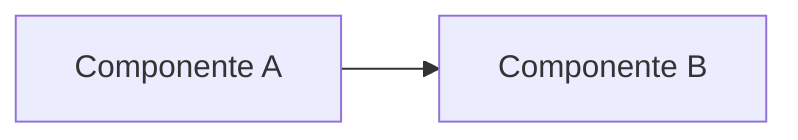

# Lab NN — <Título descriptivo en imperativo>

<!--
Instrucciones de uso de la plantilla:
1. Copia este archivo a labs/lab-NN-<slug-en-kebab-case>/README.md
2. Sustituye todos los marcadores <...> y elimina las secciones que no apliquen.
3. Coloca las políticas IAM en ./policies/*.json, los scripts en ./scripts/ y los datos de ejemplo en ./sample-data/
4. Nunca incluyas IDs de cuenta, ARNs reales, claves ni datos personales: usa marcadores (__ACCOUNT_ID__) o 111122223333.
-->

| Campo | Valor |
|---|---|
| **Dominio(s) del examen** | <p. ej., D3 — Aplicaciones de FMs (task 3.1); D5 — Seguridad (task 5.1)> |
| **Nivel** | <Básico / Intermedio / Avanzado> |
| **Duración estimada** | <60 min> |
| **Costo estimado** | <USD X si se limpia al terminar — ver [Costos](#costos)> |
| **Región probada** | <us-east-1> |
| **Servicios** | <Amazon Bedrock, Amazon S3, ...> |
| **Última verificación** | <AAAA-MM> |

## Objetivos de aprendizaje

Al finalizar este laboratorio serás capaz de:

1. <Verbo medible + resultado, p. ej., "Crear una Knowledge Base de Bedrock conectada a S3">
2. <...>
3. <...>

## Arquitectura



<Explicación breve del flujo de datos y de las decisiones de diseño.>

## Prerrequisitos

- [ ] Cuenta de AWS con permisos para <servicios>.
- [ ] AWS CLI v2 configurada (`aws sts get-caller-identity` funciona).
- [ ] <Acceso al modelo X habilitado en Amazon Bedrock>.
- [ ] <Python 3.10+ con dependencias de `scripts/requirements.txt`>.

## IAM mínimo viable

| Identidad | Permisos | Archivo |
|---|---|---|
| <Rol de servicio> | <acciones y recursos> | `policies/<archivo>.json` |
| <Usuario/rol del lab> | <acciones y recursos> | `policies/<archivo>.json` |

> Justifica cada permiso: por qué es necesario y cómo se acota el recurso.

## Pasos

### Paso 0 — Variables de entorno

```bash
export AWS_REGION=us-east-1
export AWS_ACCOUNT_ID=$(aws sts get-caller-identity --query Account --output text)
```

### Paso 1 — <Título>

<Explicación del *por qué* antes del *cómo*.>

```bash
# comando
```

**Resultado esperado:** <qué debe observarse>.

### Paso N — <Título>

## Validación

- [ ] <Comprobación 1 con comando y salida esperada>
- [ ] <Comprobación 2>

## Troubleshooting

| Síntoma | Causa probable | Solución |
|---|---|---|
| <Error> | <Causa> | <Acción> |

## Costos

| Recurso | Modelo de precios | Estimación para la duración del lab |
|---|---|---|
| <Recurso> | <por hora / por token / por GB> | <USD> |

> Precios de referencia en <región> a fecha <AAAA-MM>. Verifica siempre en la [AWS Pricing Calculator](https://calculator.aws/).

## Limpieza

> ⚠️ Ejecuta la limpieza en orden inverso a la creación para evitar dependencias huérfanas y cargos recurrentes.

```bash
# comandos de borrado
```

## Conexión con el examen

| Concepto practicado | Cómo aparece en el examen |
|---|---|
| <Concepto> | <Tipo de escenario / palabra clave> |

## Retos opcionales

1. <Extensión del lab>

## Referencias

- <Documentación oficial de AWS>
