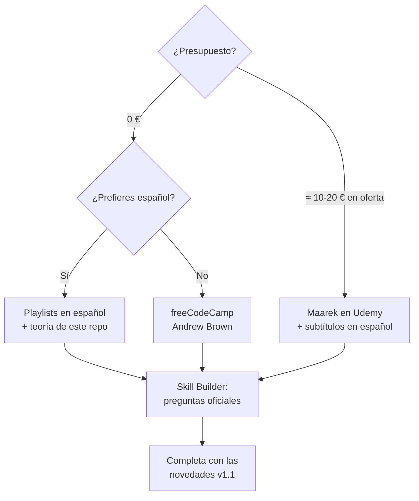

# Videos y Cursos

[⬅️ Centro de recursos](README.md)

> **Antes de empezar un curso:** comprueba su **fecha de última actualización**. Si es anterior a mayo de 2026, complétalo con las [novedades de la guía v1.1](../domains/00-exam-guide-v1.1-changes.md).

## 1. En español 🇪🇸

| Recurso | Costo | Tipo | Notas |
|---|---|---|---|
| [AWS AI Practitioner AIF-C01: qué necesitas para aprobar](https://www.youtube.com/watch?v=oJvQoyybR3M) | 🆓 | Video 👥 | Introducción reciente a los dominios del examen para principiantes. Buen punto de partida. |
| [Lista: AWS Certified AI Practitioner (AIF-C01) — curso para rendir el examen](https://www.youtube.com/playlist?list=PLrwM5pP7byUOKB58QZDV5MMXXWAy5sUdx) | 🆓 | Playlist 👥 | Curso orientado al examen. |
| [Lista: AWS Certified AI Practitioner (AIF-C01) — IA generativa y servicios gestionados](https://www.youtube.com/playlist?list=PLrwM5pP7byUOi9DdCyMzzIxw4QFrDy8RP) | 🆓 | Playlist 👥 | Enfoque en GenAI. |
| [Dominio 1 — curso completo](https://www.youtube.com/watch?v=xF-MifmtWpM) · [Dominio 2](https://www.youtube.com/watch?v=JW_iuprGirw) | 🆓 | Video 👥 ⚠️ v1.0 | Serie por dominios publicada hace más de un año. |
| Cursos de GenAI en español en [AWS Skill Builder](https://skillbuilder.aws/) | 🆓 | Curso 🏛️ | Filtra por idioma "Español" (p. ej., *Introducción a Amazon Bedrock*). |
| Canal de YouTube de **Marcia Villalba** (Developer Advocate de AWS) | 🆓 | Video 👥 | Tutoriales generales de AWS en español (canal personal, no específico del examen). |

> **Consejo:** los cursos en inglés de Udemy y Coursera ofrecen **subtítulos automáticos en español**. Combinar un curso en inglés subtitulado con la teoría en español de este repo es la ruta más completa.

## 2. En inglés — gratuitos 🆓

| Recurso | Duración | Notas |
|---|---|---|
| ⭐ [freeCodeCamp — AWS Certified AI Practitioner Full Course (Andrew Brown, ExamPro)](https://www.freecodecamp.org/news/prepare-to-pass-the-aws-certified-ai-practitioner-certification/) | ≈ 15 h | El curso gratuito más completo. Video en YouTube: [WZeZZ8_W-M4](https://www.youtube.com/watch?v=WZeZZ8_W-M4) (comprueba que sea el canal de freeCodeCamp). ⚠️ v1.0: la comunidad recomienda complementarlo con exámenes de práctica. |
| [Playlist "AWS Certified AI Practitioner (AIF-C01) — Full Course"](https://www.youtube.com/playlist?list=PL7Jj8Ba9Yr6BLf2lS4Nfa2jdl0KpdvqYC) | — | 👥 Canal no verificado. |
| [Playlist "AWS AI Practitioner AIF-C01 Certification Course" (+100 lecciones)](https://www.youtube.com/playlist?list=PLBfufR7vyJJ5nIAaEG2wju_LBm6L64PTB) | — | 👥 Canal no verificado. |
| [AWS Skill Builder — Exam Prep Standard Course](https://skillbuilder.aws/learning-plan/3NRN71QZR2/exam-prep-plan-aws-certified-ai-practitioner-aifc01--english/FBV4STG94B) | ≈ 8 h | 🏛️ Oficial. |

## 3. En inglés — de pago 💲

| Curso | Plataforma | Notas |
|---|---|---|
| ⭐ [Ultimate AWS Certified AI Practitioner AIF-C01 — Stéphane Maarek](https://www.udemy.com/course/aws-ai-practitioner-certified/) | Udemy | El más recomendado por la comunidad. ≈ 10 h, 148 lecciones, incluye un examen de práctica; **actualizado en 2026** según su ficha; subtítulos automáticos en español. Espera a las ofertas de Udemy (suelen bajar mucho el precio). |
| [AWS Certified AI Practitioner](https://www.coursera.org/learn/aws-certified-ai-practitioner) | Coursera | Curso estructurado con evaluaciones. |
| [AWS Certified AI Practitioner](https://learn.kodekloud.com/courses/aws-certified-ai-practitioner) | KodeKloud | Incluye laboratorios. |
| [AWS Certified AI Practitioner (AIF-C01)](https://www.cbtnuggets.com/it-training/aws/certified-ai-practitioner) | CBT Nuggets | Suscripción. |

## 4. ¿Qué curso elijo?

